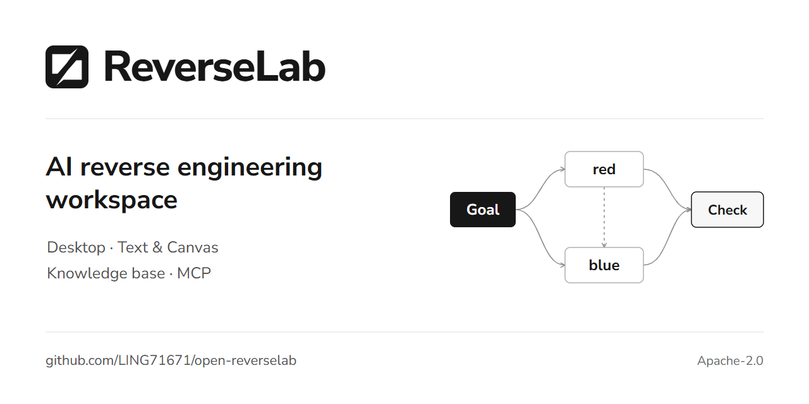
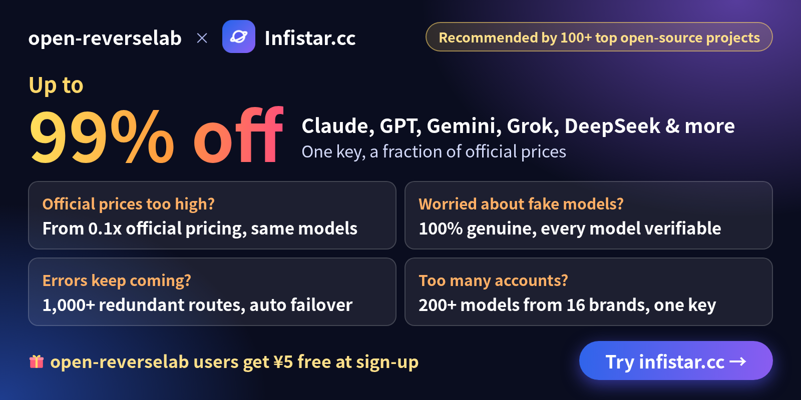
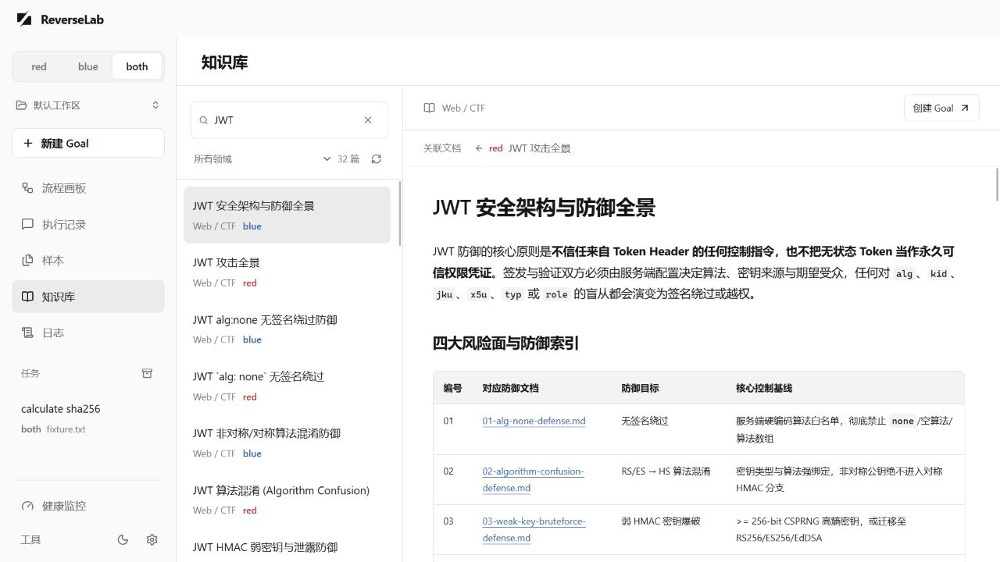

<div align="center">

# Open ReverseLab



**An AI workspace for target-based reverse engineering**

Desktop workspaces · red / blue / both · Parallel Goals · Knowledge base · MCP

<p><strong>English</strong> · <a href="README.zh.md">简体中文</a></p>

<p><a href="https://github.com/LING71671/open-reverselab/releases/tag/v2.0.0-beta.1"><strong>Download Windows beta</strong></a> &nbsp; · &nbsp; <a href="desktop/README.md">Desktop guide</a> &nbsp; · &nbsp; <a href="https://ling71671.github.io/open-reverselab/">Website & docs</a> &nbsp; · &nbsp; <a href="kb/README.md">Knowledge base</a></p>

[](https://github.com/LING71671/open-reverselab/releases)
[](LICENSE)
[](https://deepwiki.com/LING71671/open-reverselab)

</div>

## Sponsors

<table width="100%">
  <tr>
    <td width="46%" align="center" valign="middle"><a href="https://infistar.cc/register?aff=OPENREVERSELAB&amp;ref_source=link"></a></td>
    <td valign="middle"><p><strong><a href="https://infistar.cc/register?aff=OPENREVERSELAB&amp;ref_source=link">Infistar.cc</a></strong></p><p>Claude, GPT, Gemini, Grok and DeepSeek with one key, up to 99% off official prices. 100% genuine models, every model verifiable, with 1,000+ redundant routes and automatic failover. Access 200+ models from 16 brands for AI reverse engineering and MCP workflows.</p><p><a href="https://infistar.cc/register?aff=OPENREVERSELAB&amp;ref_source=link"><strong>Sign up for CNY 5 in free credit</strong></a></p></td>
  </tr>
  <tr>
    <td align="center" valign="middle"><a href="https://sentry.io"><picture><source media="(prefers-color-scheme: dark)" srcset="assets/sponsors/sentry-wordmark-dark.svg"></picture></a></td>
    <td valign="middle"><p><strong><a href="https://sentry.io">Sentry</a></strong></p><p>Sponsored account for error monitoring and performance tracing across the project toolchain.</p></td>
  </tr>
</table>

<p align="center"><sub>Sponsor details and ways to support the project: <a href="SPONSORS.md">SPONSORS.md</a></sub></p>

## Desktop

Select `red / blue / both` in the upper-left corner, choose a workspace, and enter a file, directory, or URL target with a Goal. The live canvas shows execution branches; activity, logs, reports, and health views retain the evidence behind the result.



- **Independent strategies.** `red` and `blue` use separate analysis policies. `both` lets each strategy plan multiple actions, exchange evidence during execution, and independently check their results before combined verification.
- **Concurrent Goals.** Goals and ready actions run concurrently without an application-level count limit. Switching views, tasks, or workspaces does not redirect a running task's output.
- **Managed workspaces.** First launch creates a default workspace. Open or create others, import samples, and keep original and working copies separate.
- **Goal control.** Goals have no time or token limit by default. Set either limit when needed, stop a run, or add instructions while it is running. Verification results and failed attempts remain in the execution history.
- **Knowledge and usability.** Browse defense articles and paired references, switch light/dark themes, and retain unsent drafts, reading positions, and filters during navigation.

### Download and setup

[v2.0.0-beta.1](https://github.com/LING71671/open-reverselab/releases/tag/v2.0.0-beta.1) includes a Windows x64 installer and portable ZIP, with signature files and SHA256 checksums. You can also [build from source](#build-the-desktop).

1. Install Python 3.11 or newer and make the `python` command available on PATH. Windows also needs the Microsoft Edge WebView2 runtime.
2. Run the installer, or extract the complete portable ZIP and launch `OpenReverseLab.exe`. Keep personal workspaces outside the source and installation directories.
3. Open Settings and configure an OpenAI-compatible chat-completions endpoint and model, then enter a target and objective. SHA256 verification can run locally without a model.

Windows x64 is the desktop packaging target. Python and third-party tools such as Ghidra, Frida, and x64dbg are installed separately. macOS/Linux support the source-based CLI/MCP workflow; native desktop packages for those platforms are not currently provided. The installed edition offers Beta and Stable update channels; beta builds select Beta initially. See [application updates](desktop/UPDATES.md).

The desktop executes target triage and Python actions without a default tool time limit. MCP tool references in KB articles do not automatically become desktop adapters for debuggers, devices, or hardening tools. Workspace files stay on disk, while model-assisted runs send task context and selected evidence to the endpoint you configure. Python actions run with the current user's permissions. See the [desktop guide](desktop/README.md) for configuration, data handling, and limits.

## Knowledge base and MCP

The knowledge base covers Web/CTF, Android/APK, Windows/PE, and general topics such as cryptography and protocols. Articles carry `track: red | blue | both`; `both` articles are shared. Related attack and defense articles are linked through index metadata and `defends` references. The current catalog is the source of truth; not every article has a one-to-one counterpart.

| Area | Knowledge entry | Tool examples |
| --- | --- | --- |
| Web / CTF | [Web knowledge](kb/shared/ctf-website/README.md) | `kb_router`, `http_probe`, `run_ctf_tool` |
| Android / APK | [APK knowledge](kb/shared/apk-reverse/README.md) | `android_app_baseline`, `android_crypto_unpack_recipe` |
| Windows / PE | [PE knowledge](kb/shared/pe-reverse/README.md) | `triage_pe`, `ghidra_headless_analyze`, `sample_full_workup` |
| General | [Cross-domain knowledge](kb/shared/general/README.md) | `solve_crypto_from_evidence`, `rizin_*` |

CLI/MCP track selection defaults to `blue`; select `red` or `both` explicitly through `REVERSELAB_MODE`, `--track`, or the MCP track tools. Desktop selection is scoped to its Goals and does not rewrite another client's environment.

```sh
python scripts/misc/kb_router.py "JWT" --track blue
python scripts/misc/desktop_kb.py list --track both
```

## CLI and AI-agent setup

Clone the repository, then use `START_HERE.bat` / `START_HERE.cmd` on Windows or `./START_HERE.sh` on macOS/Linux. These are setup and MCP checks, not the desktop launcher. The reports are written under `reports/misc/`.

```sh
git clone https://github.com/LING71671/open-reverselab.git
cd open-reverselab
```

Open this directory in your AI client and read [AI-USAGE.md](AI-USAGE.md). The context chain is `CLAUDE.md → AGENTS.md → AI-USAGE.md → boards/<board>/AI-USAGE.md`. For guided installation, use the [English](templates/prompts/ai-install.en.md) or [Chinese](templates/prompts/ai-install.zh.md) prompt. MCP clients need `uv` and the dependencies in `tools/skills/mcp/ReverseLabToolsMCP`.

```sh
uv sync --project tools/skills/mcp/ReverseLabToolsMCP
uv run --project tools/skills/mcp/ReverseLabToolsMCP python scripts/misc/mcp_smoke_check.py --write-report
python scripts/misc/lab_healthcheck.py
python scripts/misc/ai_toolcheck.py --board misc
```

Install only the tool groups needed for the task. Windows provides `scripts/misc/install_tools.ps1 -CTF`, `-Android`, `-Windows`, and `-Common`; POSIX wrappers are generated by `scripts/misc/bootstrap.sh`. See [START.md](START.md) and [tools/README.md](tools/README.md).

## Build the desktop

With Node 22+, pnpm, Python, Rust, and the platform Tauri prerequisites installed:

```sh
cd desktop
pnpm install --frozen-lockfile
pnpm tauri dev
# Or create a production executable:
pnpm tauri build --no-bundle
```

`pnpm dev` is the browser preview. See [development](desktop/DEV_GUIDE.md), [architecture](desktop/ARCHITECTURE.md), [Agent contracts](desktop/AGENT_SYSTEM.md), [error codes](desktop/ERROR_CODES.md), and [release instructions](RELEASING.md).

## Data and repository layout

| Location | Purpose |
| --- | --- |
| `desktop/` | Desktop UI, queue, execution engine, and Tauri host |
| `kb/` | Reusable techniques and defense references |
| `scripts/`, `tools/`, `templates/` | Automation, adapters, and templates |
| `boards/` | Task routing for external AI clients |
| `site/` | Documentation-site source |
| Selected workspace's `.reverselab/` | Desktop originals/work copies, Goal records, exports, and reports |
| Repository `cases/`, `samples/`, `notes/`, `exports/`, `reports/` | Local CLI analysis artifacts; excluded from publication |

Desktop data defaults to `~/.open-reverselab/workspaces/Default`. The host environment snapshot is separate at `~/.open-reverselab/env/env.md`. Neither belongs in a public commit. See [workspace storage](desktop/WORKSPACES.md).

## Contributing and publication

Read [Contributing](.github/CONTRIBUTING.md), [Security](SECURITY.md), and [Publication](PUBLICATION.md). Publish general implementations and synthetic examples; keep real targets, samples, credentials, and case evidence private. Before submitting, run `python scripts/misc/public_release_check.py` and the checks relevant to the changed module. Release history is in [CHANGELOG.md](CHANGELOG.md).

---

## Star History

<div align="center">

<a href="https://star-history.com/#LING71671/open-reverselab&Date">
  <picture>
    <source media="(prefers-color-scheme: dark)" srcset="https://api.star-history.com/svg?repos=LING71671/open-reverselab&type=Date&theme=dark" />
    <source media="(prefers-color-scheme: light)" srcset="https://api.star-history.com/svg?repos=LING71671/open-reverselab&type=Date" />
    
  </picture>
</a>

</div>

---

## Disclaimer

By accessing or using this project, you agree to be bound by the full disclaimer — covering all versions and branches, all users (direct and indirect), all derivatives, legal compliance across all jurisdictions (including export controls and data protection laws), authorized purposes only, prohibited uses, no warranty, limitation of liability, mandatory disclaimer retention in derivatives, AI/ML training protections, and more.

> :page_facing_up: Full legal text: [DISCLAIMER.md](DISCLAIMER.md) · [中文版](DISCLAIMER.zh.md)

## License

**Apache-2.0.** See [LICENSE](LICENSE). By contributing, you agree your contributions are licensed under the same terms.
