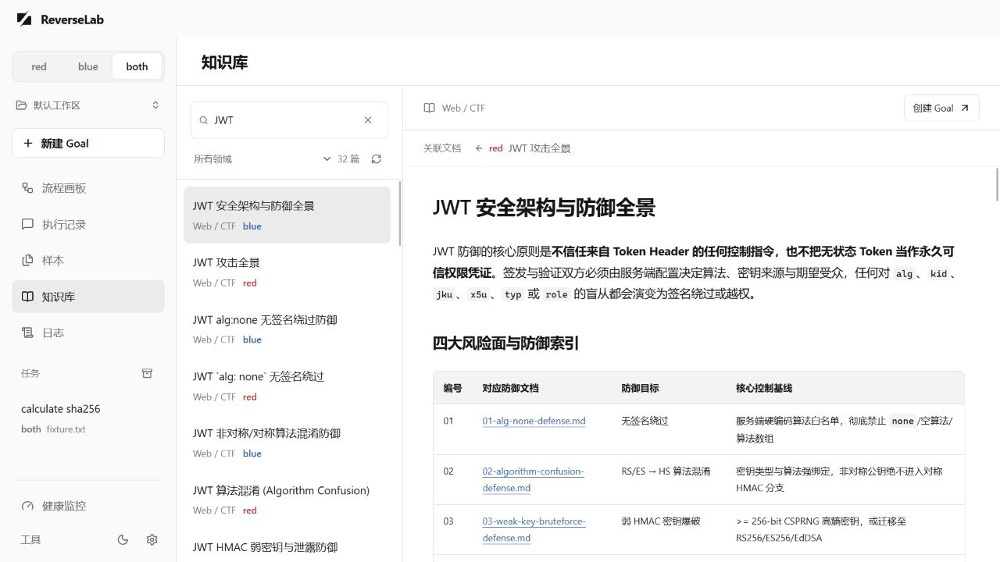

# Open-ReverseLab

ReverseLab 提供桌面工作区、红蓝知识库和 MCP 工具，用于围绕目标开展分析。可以在桌面端运行与查看 Goal，也可以将仓库接入 Claude Code、Codex、OpenCode 等 MCP 客户端。

[English](README.md) · **简体中文**

[下载 v2.0.0](https://github.com/LING71671/open-reverselab/releases/tag/v2.0.0) · [桌面端说明](desktop/README.zh-CN.md) · [知识库](kb/README.md) · [文档站](https://ling71671.github.io/open-reverselab/)

[](https://deepwiki.com/LING71671/open-reverselab)
[](LICENSE)

## :handshake: 赞助支持

<table width="100%">
  <tbody>
    <tr>
      <td width="380" align="center" valign="middle">
        <a href="https://sentry.io"><picture>
          <source media="(prefers-color-scheme: dark)" srcset="assets/sponsors/sentry-wordmark-dark.svg">
          
        </picture></a>
      </td>
      <td valign="middle">
        <strong><a href="https://sentry.io">Sentry</a></strong><br /><br />
        为 <code>openreverselab</code> 提供赞助账户 —— 行业领先的错误监控与性能追踪平台，保障自动化工具链稳定运行。
      </td>
    </tr>
  </tbody>
</table>

<p align="center"><sub>完整赞助名单与赞助方式见 <a href="SPONSORS.md">SPONSORS.md</a>。</sub></p>

---

## 桌面端

在左上角选择 `red / blue / both`，选好工作区，填写文件、目录或 URL 目标和任务内容。实时流程画板展示执行分支，执行记录、日志、报告和健康监控保留结论所依据的证据。



- **策略独立。** red 与 blue 分别维护分析策略，both 并行运行两个分支并汇总各自结果。
- **多任务并行。** 每个工作区默认同时运行两个 Goal。切换页面、任务或工作区不会改变后台任务的输出归属。
- **工作区管理。** 首次启动创建默认工作区，也可新建或打开其他目录。导入样本时保留原件，另建工作副本。
- **目标与运行限制。** 时间和 Token 上限可选，默认每个 Goal 为 10 分钟、32,000 tokens。失败路线和重复动作反馈给规划器，目标是否完成由独立核验决定。
- **知识库与操作体验。** 支持 defense 文档、关联阅读、深浅主题；页面切换时保留未提交草稿、阅读位置和筛选条件。

### 下载与启动

1. 从 [Release](https://github.com/LING71671/open-reverselab/releases/tag/v2.0.0) 下载并运行 `ReverseLab-v2.0.0-windows-x64-setup.exe`。
2. 安装 Python 3.10 或更新版本，确保终端能执行 `python`。Windows 还需要 Microsoft Edge WebView2 Runtime。
3. 启动 ReverseLab。安装包包含知识库和项目脚本；个人工作区请放在安装目录之外。
4. 在设置中配置兼容 OpenAI chat-completions 的 API 地址和模型，再填写目标和任务内容。SHA256 核验可直接在本地运行，无需模型。

设置中可检查版本、查看发布说明并下载签名更新。便携 ZIP 可检查版本，通过安装包迁移；使用便携版时完整解压并保留 `ReverseLab.exe` 旁的 `kb/` 和 `scripts/`。详见[应用更新](desktop/UPDATES.md)。

发布包包含 Windows x64 程序和对应版本的项目源码、脚本、知识库。Python、Ghidra、Frida、x64dbg 等外部工具需另行安装。macOS/Linux 可继续使用源码形式的 CLI/MCP 工作流；本版本未提供这两个平台的桌面二进制。

桌面端当前直接执行有界 Python 观察脚本。知识库中的 MCP 工具名不会自动成为调试器、设备或加固执行适配器。工作区文件保存在本地，模型辅助任务会把任务上下文和所选证据发送到配置的模型端点；Python 动作继承当前用户权限。配置、数据流向和能力范围见[桌面端说明](desktop/README.zh-CN.md)。

## 知识库与 MCP

知识库覆盖 Web/CTF、Android/APK、Windows/PE，以及密码学、协议等通用主题。文档用 `track: red | blue | both` 标记所属轨道，其中 `both` 表示共享。攻击与防御文档通过索引元数据和 `defends` 关联；实际目录为准，并非每篇文章都存在一对一对应项。

| 领域 | 知识入口 | 工具示例 |
| --- | --- | --- |
| Web / CTF | [Web 知识库](kb/ctf-website/README.md) | `kb_router`、`http_probe`、`run_ctf_tool` |
| Android / APK | [APK 知识库](kb/apk-reverse/README.md) | `android_app_baseline`、`android_crypto_unpack_recipe` |
| Windows / PE | [PE 知识库](kb/pe-reverse/README.md) | `triage_pe`、`ghidra_headless_analyze`、`sample_full_workup` |
| 通用 | [跨领域知识库](kb/general/README.md) | `solve_crypto_from_evidence`、`rizin_*` |

CLI/MCP 默认使用 `blue`，可通过 `REVERSELAB_MODE`、`--track` 或 MCP 轨道工具显式切换。桌面端的模式属于各自 Goal，不会改写其他客户端的环境变量。

```sh
python scripts/misc/kb_router.py "JWT" --track blue
python scripts/misc/desktop_kb.py list --track both
```

## CLI 与 AI Agent 入门

克隆仓库后，Windows 使用 `START_HERE.bat` / `START_HERE.cmd`，macOS/Linux 使用 `./START_HERE.sh`。这些入口负责环境和 MCP 检查，桌面程序单独启动。检查报告写入 `reports/misc/`。

```sh
git clone https://github.com/LING71671/open-reverselab.git
cd open-reverselab
```

在 AI 客户端打开目录并阅读 [AI-USAGE.md](AI-USAGE.md)。上下文链为 `CLAUDE.md → AGENTS.md → AI-USAGE.md → boards/<board>/AI-USAGE.md`。需要 AI 协助安装时使用[中文提示词](templates/prompts/ai-install.zh.md)。MCP 客户端需要 `uv` 和 `tools/skills/mcp/ReverseLabToolsMCP` 中的依赖。

```sh
uv sync --project tools/skills/mcp/ReverseLabToolsMCP
uv run --project tools/skills/mcp/ReverseLabToolsMCP python scripts/misc/mcp_smoke_check.py --write-report
python scripts/misc/lab_healthcheck.py
python scripts/misc/ai_toolcheck.py --board misc
```

按任务安装工具组。Windows 提供 `scripts/misc/install_tools.ps1 -CTF`、`-Android`、`-Windows`、`-Common`；POSIX wrapper 由 `scripts/misc/bootstrap.sh` 生成。详见 [START.md](START.md) 与 [tools/README.md](tools/README.md)。

## 从源码运行桌面端

准备 Node 22+、pnpm、Python、Rust 和当前平台的 Tauri 构建依赖：

```sh
cd desktop
pnpm install --frozen-lockfile
pnpm tauri dev
# 构建生产程序：
pnpm tauri build --no-bundle
```

`pnpm dev` 启动浏览器预览。详见[开发指南](desktop/DEV_GUIDE.md)、[架构图](desktop/ARCHITECTURE.md)、[Agent 契约](desktop/AGENT_SYSTEM.md)、[错误码](desktop/ERROR_CODES.md)和[发布说明](RELEASING.md)。

## 数据与目录

| 位置 | 用途 |
| --- | --- |
| `desktop/` | 桌面 UI、队列、执行引擎与 Tauri 宿主 |
| `kb/` | 通用技术与防御知识 |
| `scripts/`、`tools/`、`templates/` | 自动化脚本、适配器和模板 |
| `boards/` | 外部 AI 客户端的任务路由 |
| `site/` | 文档站源码 |
| 所选工作区的 `.reverselab/` | 桌面样本原件／副本、Goal、输出与报告 |
| 仓库内 `cases/`、`samples/`、`notes/`、`exports/`、`reports/` | CLI 本地分析产物，不进入公开发布 |

桌面默认数据目录为 `~/.open-reverselab/workspaces/Default`。本机环境快照另存于 `~/.open-reverselab/env/env.md`；二者都不能提交到公共仓库。备份与迁移见[工作区文档](desktop/WORKSPACES.md)。

## 参与贡献与发布

请阅读[贡献指南](.github/CONTRIBUTING.md)、[安全策略](SECURITY.md)与[公开边界](PUBLICATION.md)。提交通用实现和合成示例，真实目标、样本、凭据和案例证据留在本地。提交前运行 `python scripts/misc/public_release_check.py` 及所改模块的检查。版本历史见 [CHANGELOG.md](CHANGELOG.md)。

## 赞助方

ReverseLab 的持续运营靠的是为基础设施、工具、审稿时间投入资源的人与组织。

<table width="100%">
  <thead>
    <tr>
      <th width="180" align="left">Logo</th>
      <th align="left">赞助方 / Sponsor</th>
      <th width="110" align="left">时间 / Since</th>
      <th align="left">支持内容 / Support</th>
    </tr>
  </thead>
  <tbody>
    <tr>
      <td align="left" valign="middle">
        <a href="https://sentry.io"><picture>
          <source media="(prefers-color-scheme: dark)" srcset="assets/sponsors/sentry-wordmark-dark.svg">
          
        </picture></a>
      </td>
      <td valign="middle"><strong><a href="https://sentry.io">Sentry</a></strong></td>
      <td valign="middle">2026-08</td>
      <td valign="middle">赞助账户 —— 错误监控与性能追踪平台（error monitoring &amp; performance tracing）</td>
    </tr>
  </tbody>
</table>

**想成为赞助方？** 见 [SPONSORS.md](SPONSORS.md)，或邮件联系 **belloshehubz@gmail.com** —— 无论大小，每一位赞助者都会被列出，并注明所提供支持。

---

## Star History

<div align="center">

<a href="https://star-history.com/#LING71671/open-reverselab&Date">
  <picture>
    <source media="(prefers-color-scheme: dark)" srcset="https://api.star-history.com/svg?repos=LING71671/open-reverselab&type=Date&theme=dark" />
    <source media="(prefers-color-scheme: light)" srcset="https://api.star-history.com/svg?repos=LING71671/open-reverselab&type=Date" />
    
  </picture>
</a>

</div>

---

## 免责声明

**访问或使用本项目即表示同意受完整免责声明的约束。** 声明涵盖：所有版本与分支（追溯及前瞻）、所有使用者（直接与间接）、所有衍生作品（fork / 复制 / 再分发）、全部司法管辖区的法律合规（含出口管制与数据保护法）、仅限授权用途、禁止用途、无担保、责任限制与赔偿、衍生作品强制保留声明、AI/ML 训练保护等。

> :page_facing_up: 完整法律文本：[DISCLAIMER.zh.md](DISCLAIMER.zh.md) · [English](DISCLAIMER.md)

## 许可协议

**Apache-2.0。** 详见 [LICENSE](LICENSE)。贡献即表示你同意你的贡献以相同条款授权。
