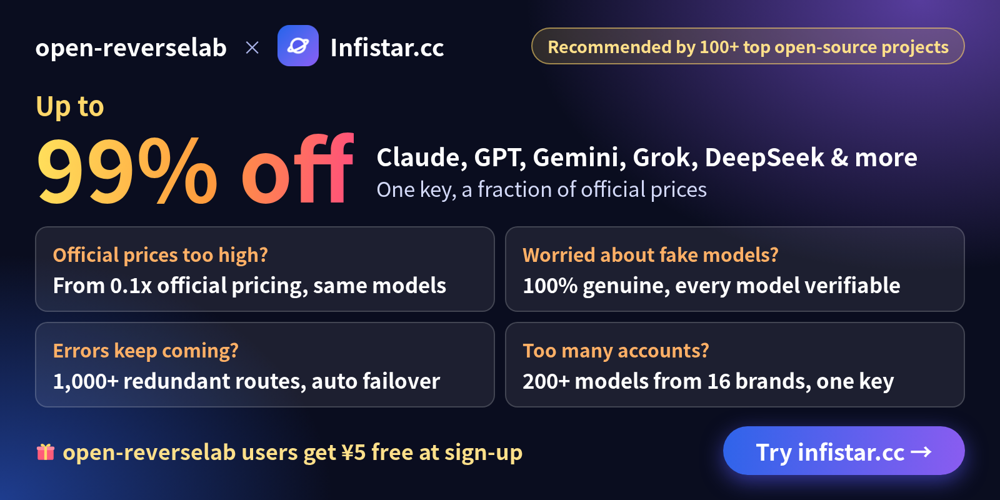

# Sponsors / 赞助

Thanks to everyone who supports this project. ❤️
感谢每一位支持本项目的人。❤️

## Current Sponsors / 当前赞助

<table width="100%">
  <thead>
    <tr>
      <th width="180" align="left">Logo</th>
      <th align="left">Sponsor / 赞助方</th>
      <th width="110" align="left">Since / 时间</th>
      <th align="left">Support / 支持内容</th>
    </tr>
  </thead>
  <tbody>
    <tr>
      <td align="left" valign="middle">
        
      </td>
      <td valign="middle"><strong><a href="https://infistar.cc/register?aff=OPENREVERSELAB&amp;ref_source=link">Infistar.cc</a></strong></td>
      <td valign="middle">2026-11</td>
      <td valign="middle">
        Unified multi-model API gateway (Claude, GPT, Gemini, Grok, DeepSeek &amp; more) · ¥5 free sign-up credit. 
        统一多模型 API 接入平台（Claude、GPT、Gemini、Grok、DeepSeek 等）· 专属链接注册赠 ¥5 体验额度。
      </td>
    </tr>
    <tr>
      <td align="left" valign="middle">
        <a href="https://sentry.io"><picture>
          <source media="(prefers-color-scheme: dark)" srcset="assets/sponsors/sentry-wordmark-dark.svg">
          
        </picture></a>
      </td>
      <td valign="middle"><strong><a href="https://sentry.io">Sentry</a></strong></td>
      <td valign="middle">2026-08</td>
      <td valign="middle">
        Sponsored account — error monitoring &amp; performance tracing platform. 
        赞助账户 —— 错误监控与性能追踪平台。
      </td>
    </tr>
  </tbody>
</table>

## How to sponsor / 如何赞助

Interested in sponsoring this project? Email: **belloshehubz@gmail.com**
想赞助本项目？欢迎来信：**belloshehubz@gmail.com**
