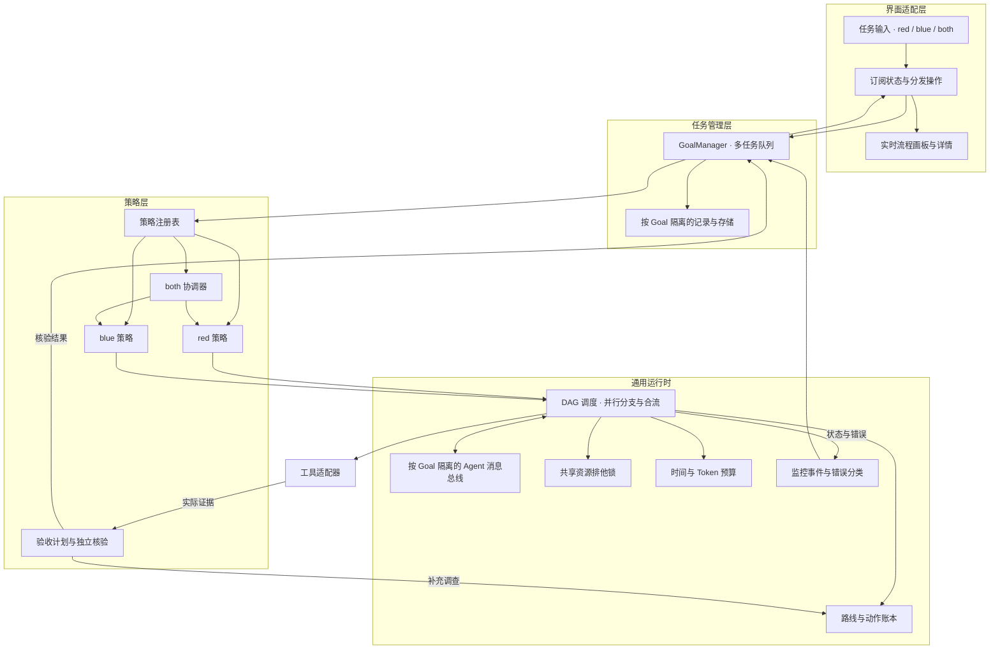

# 桌面智能体系统

桌面端用左上角的 `red` / `blue` / `both` 选择任务策略，保留实时流程画板。运行时围绕用户目标选择动作、收集证据、检查进展；当前路线受阻时选择有差异的下一条路线，直到目标经过核验、预算耗尽、用户停止或当前已知可执行路线耗尽。

用户给出目标与任务，可选时间和 Token 预算。AI 负责规划验收条件、选择路线、并行执行、核验与补充调查。用户无需逐次选择工具、批准常规路线切换或手动判定每项检查；桌面保留停止与查看证据的入口。

本文区分应遵守的运行契约与当前实现边界。代码中的执行成功、报告生成和目标完成是不同结果，界面与报告必须保留这种区别。

## 策略与运行时

策略负责回答“为什么做、观察什么、怎样才算完成”。通用调度器只处理依赖、并发和取消；工具适配器执行动作，预算模块限制消耗，消息总线传递证据，监控模块归类状态。任务管理层接受注入的 runner 和 storage，不依赖 React；DAG、消息总线和监控不依赖具体模型或工具。独立动作通过异步 runner 实际同时执行，界面根据执行事件绘图。

| 模块 | 自己拥有的内容 | 共享的内容 |
| --- | --- | --- |
| `red` | 目标解释、分析假设、验收计划、动作选择规则与目标核验规则 | 工具适配器、知识库读取、事件格式、预算实现 |
| `blue` | 防御问题、验收计划、证据要求、检测或修复验证规则 | 同上 |
| `both` | 两个子任务的启动、额度分配、显式证据交接和结果汇总 | 同一个运行总预算 |

`both` 分别运行 red 与 blue 策略，保留各自的上下文、候选路线、执行记录和核验结果。两条分支只通过标明来源的证据引用交换信息。一个分支的成功或失败不能直接改变另一分支的结论；只有任务要求的两个分支均通过各自核验，汇总结果才可以标为目标完成。

`red` 读取 red 与共享文档，`blue` 读取 blue 与共享文档。`both` 的每个子任务按自己的策略读取文档；相关文档链接帮助另一分支定位材料，不改变文档所属策略。

## 多任务与单个 Goal 内的并行

并行有两个独立层次。GoalManager 默认同时启动所有提交的用户 Goal；每个 Goal 的 DAG 调度器默认启动所有依赖已满足且资源可用的动作。应用不设置 Goal、分支或单轮动作数量上限。开始、取消、归档和查看一个 Goal 不应改变另一个 Goal 的目标、预算、消息、证据或模型配置。

任务提交时复制并固定目标、意图、策略与预算。回调绑定该 Goal ID，不依赖界面当前选中的会话。已取消或已结束的任务拒绝晚到的流式更新。取消排队任务不调用执行器；取消运行任务传递取消信号，并等待实际执行器退出后释放运行名额。

单个 Goal 的任务网络由 `id`、`parentIds`、`run` 和依赖策略组成，启动前检查重复 ID、缺失依赖和环。一个节点在一次调度中最多执行一次；需要重试或新路线时创建新动作并保留原节点。调度器支持任意有限无环图，本轮 `both` 使用实际并行的 red、blue 分支和一个合流节点。

| 依赖策略 | 节点何时运行 | 典型用途 |
| --- | --- | --- |
| `allSucceeded` | 所有父节点成功 | 需要前置产物的普通动作 |
| `allSettled` | 所有父节点进入终态 | 汇总成功、失败与取消结果的合流节点 |

普通节点的必需父节点失败时，该节点取消执行；无关分支继续。合流节点收到每个直接父节点的状态、结果或错误，统一处理部分成功，不能只收成功结果。`cancelBranch` 取消普通后代，在 `allSettled` 合流边界停止传播；全局取消则覆盖所有节点。

节点状态为 `queued`、`running`、`succeeded`、`failed`、`cancelled`。其中 `succeeded` 表示 runner 返回成功，用户目标是否完成仍由独立核验决定。取消信号发出后，尚未退出的 runner 保留运行状态和取消请求标记；并发名额与资源锁直到其实际结束才释放。

`resourceKeys` 对同一调试会话、设备或需要排他修改的文件实施互斥。独立资源可并行，冲突资源顺序执行。多个 Goal 通过注入同一个 `DagResourcePool` 共享资源锁；未注入时锁只覆盖本 DAG，不提供跨进程互斥。

## Agent 通信与运行监控

AgentMessageBus 只接受同一 Goal 中已注册 Agent 的消息，消息携带发送者、接收者、类型、关联 ID 和证据引用。支持 `evidence`、`question`、`answer`、`blocked`、`result`；重复消息 ID 不重复投递，关联回复继承跳数限制，收件箱、历史和总消息量均有上限。消息内容不能直接修改另一 Agent 的目标或判定结果。

`both` 分支在后续规划轮次读取对方收件箱，通过证据和阻塞消息补充路线判断。消息总线负责交付，策略负责解释，调度器负责是否启动动作。共享相同目标与脚本指纹的执行 Promise 可避免并行分支重复运行同一观察，但各自保留核验结果。

独立监控模块已提供有界事件记录、稳定错误分类和健康快照；节点事件、工具记录和阶段诊断是其输入。事件按 Goal、Agent、路线和动作定位，保留 trace、关联 ID、耗时与原始错误。错误代码区分输入、模型鉴权/额度/限流/超时、知识库、工具、证据、重复循环、预算、用户取消及存储问题，完整定义见 [health.ts](src/core/contracts/health.ts)。

[HealthMonitor](src/services/health/healthMonitor.ts) 汇总保留窗口中的最新分支状态；同一 trace 后来成功可恢复该分支，其他分支成功不覆盖已有失败。未观测的层保持 `unknown`，没有新事件时保留最后观测。该模块负责记录与分类，不主动探测网络或自动重试；`retryable` 与 `recovery` 是供策略使用的建议。它不生成假进度百分比，也不把界面订阅失败当成工具执行失败。

## 单次运行契约

开始运行时固定以下信息：

- 用户目标、目标引用、策略以及用户选择的时间和 Token 上限。
- 目标身份：文件优先使用规范路径与 SHA256；网络目标记录实际端点及观测来源。扩展名推断只能作为待验证的分类。
- AI 根据用户任务形成的验收计划：条件 ID、判定条件、所需证据、适用范围与核验方式。
- 本次运行 ID、分支 ID、开始时间和剩余预算。

运行期间切换顶部策略只应影响后续新任务；正在执行的任务继续使用开始时确定的策略。恢复历史记录时显示该记录自己的策略和停止状态。

每轮执行遵循以下顺序：

1. 检查取消信号、总预算和当前可执行候选。
2. 根据目标、已观测信号、可用工具和失败记录选择一条路线。
3. 在执行前固定假设、动作输入、预期观测和核验条件。
4. 检查是否已经执行过等价动作，给实际工具调用分配剩余时间内的超时。
5. 执行工具，记录实际输出、错误、耗时和生成的文件。
6. 核验证据身份、目标条件与新增信息；更新路线状态和下一动作。
7. 把事件发送到画板，再决定继续或停止。

目标发现阶段同样允许替代动作。例如，专用文件解析器缺失时，可以先用基础文件探针确认路径与哈希，再选择另一个已安装解析器。目录中的候选必须来自真实扫描结果。若目标不存在或所有发现方式均不可用，记录具体阻塞原因；不填入默认架构、默认入口点或假定的 HTTP 状态。

## 路线、动作与防循环

一条路线包含目标问题、待验证假设、适用条件、动作与可观测结果。知识库文档是选择路线的依据；更换文档本身不计作新的执行路线。

每个动作的账本至少记录：

| 内容 | 用途 |
| --- | --- |
| 运行、分支、路线和动作 ID | 将画板节点关联到实际执行 |
| 工具与规范化输入 | 判断是否重复执行同一动作 |
| 目标身份与输入版本 | 确认历史证据仍适用于当前目标 |
| 开始、结束、退出状态与错误类别 | 区分环境故障、假设失败与执行超时 |
| 原始输出或文件引用及摘要 | 复查证据，比较是否有新信息 |
| 预算消耗与数据来源 | 区分实际用量和估算 |
| 选择或关闭路线的原因 | 解释为何继续、改路或停止 |

动作指纹由目标身份、工具、规范化参数和脚本内容组成，不包含运行时间、随机节点 ID 或知识库文档名。重复动作只有在输入变化、外部状态发生相关变化，或存在明确的暂时性错误重试策略时才能再次执行。重试必须说明变化，并继续消耗原预算。

失败归类保留原始错误，同时用稳定类别识别重复失败。例如，同一依赖缺失不能通过改写脚本注释变成新路线。关闭该路线后，调度器继续检查其他满足前置条件的动作；所有仍依赖同一缺失能力的候选应一起跳过。

进展需要新增且与目标相关的事实，例如一个假设被排除、一个地址经过验证、一个响应差异被复现或一个检测条件经过测试。以下内容不能单独重置“无进展”状态：读取另一篇文档、模型改写总结、输出时间戳变化、重新打印已有哈希或脚本正常退出。

证据的新鲜度由目标及输入版本决定。相同文件哈希下的静态结论可以复用；目标文件、运行配置或相关远端状态发生变化后，应重新验证受影响的结论。跨分支传递证据时保留来源和适用条件，接收方自行判断是否适用于自己的核验条件。

## 证据与目标核验

执行结果分为三层：

| 层级 | 能够支持的结论 |
| --- | --- |
| 工具执行成功 | 进程正常退出或工具调用成功 |
| 证据可接受 | 输出可解析，目标身份匹配，观测有来源 |
| 目标经过核验 | 执行前定义的目标条件经过独立核验，并保留所用证据与判断方式 |

模型生成的 Python 可以输出结构化的 `target`、`checks` 和观测值。这能帮助采集证据，但脚本自己填写的 `passed: true` 不能决定目标完成。核验阶段应根据预先固定的 criterion、expected 和实际证据重新判断；不能在运行后把用户目标改成脚本恰好输出的内容。

独立核验包含两种方式：

- 可直接计算的条件由确定性校验器判定。例如，提取 SHA256 的结果可以与独立文件读取结果核对；算法复现可以使用固定输入输出测试。
- 需要语义判断的条件由单独的模型核验请求处理。该请求只接收原始用户目标、已固定的验收计划和实际工具证据，不沿用执行阶段自报的结论。返回 `met`、`unmet` 或 `inconclusive`，并逐项关联证据 ID、说明判断依据和需要补充的动作。

运行时检查核验输出的结构、条件 ID、目标身份和证据引用。引用不存在、属于另一目标、仅有计划描述或缺少必要观测时，不能接受 `met`。结果标明 `deterministic` 或 `model_assessed`，保留置信依据；模型判断不能标成确定性验证。

知识库正文、目标内容和工具输出作为待分析数据传入模型。它们不能修改用户目标、验收条件、预算和停止规则，也不能要求清除已有失败记录。验收计划如需细化，保留旧版本与变更理由，仍需覆盖原始目标，不能通过降低条件把阻塞改写成完成。

`unmet` 与 `inconclusive` 自动反馈到规划器，选择能补足缺口的新动作。开放目标没有固定代码校验器时，使用独立模型核验与实际证据推进；不把常规核验交回用户。若当前执行器缺少取得必要证据的能力，则尝试可用替代，最终按实际候选与预算停止，并保留尚未满足的条件。

例如，还原算法需要已知输入输出或可重复的样本行为；检测规则需要明确的命中与未命中测试证据。生成报告、模型叙述或非空标准输出不能代替这些观测。

## 预算与停止

时间预算覆盖目标发现、知识库读取、模型请求、工具执行与取证保存。控制超时使用单调计时；墙上时间仅用于记录。每次动作的时限不超过运行剩余时间，截止后不得启动下一动作。

Token 预算包括规划、执行分析与独立核验请求的输入、输出及供应商返回的其他计费 Token。请求前根据剩余额度限制输出；流式过程中持续计入消耗，失败、取消和切换路线都不能清零。供应商返回 usage 时保存实际值；未返回时记录估算并明确标识，不能把字符数称为真实 Token 数。没有精确输入计数和完整 usage 的提供方只能支持估算额度控制。

预算在任务输入中可选，默认不设置时间或 Token 上限。两个字段独立生效，留空表示不限；保存记录时省略未设置字段。每次 Python 执行仍受单动作超时限制。重复路径检测、独立核验、路线耗尽和手动停止继续生效；设置总时间上限时，单次调用不能越过截止时间。

`both` 使用同一个总截止时间，并在并行请求前分别预留 Token 子预算，两者之和不超过 Goal 预算。当前实现各预留一半，奇数余额分给 blue；不会给两个分支各复制一份总额度。跨分支转移未花费额度需要协调器显式实现，不能重置总预算。

| 停止原因 | 结果含义 |
| --- | --- |
| `goal_verified` | 当前目标条件通过独立核验 |
| `time_budget` | 时间上限已到，保留部分结果 |
| `token_budget` | 实际或标明估算的 Token 额度已耗尽 |
| `routes_exhausted` | 当前已知、适用且可执行的候选已尝试或被排除 |
| `dependency_blocked` | 必需目标、工具或服务不可用，且无已知替代 |
| `cancelled` | 用户停止运行 |

若另设动作次数或无进展次数上限，应另外报告 `attempt_limit` 或 `no_progress`，不能称为全部路线耗尽。“当前候选耗尽”仅描述本轮掌握的候选，不宣称所有可能方法均已证明失败。

取消模型流、停止调度与终止原生子进程是三个不同动作。界面只有在原生执行器确认退出后，才能显示工具已经停止；如仍在收尾，应保留相应状态。

## 桌面交互与画板

左上角固定三个英文选项 `red` / `blue` / `both`。主要界面只保留目标、任务、预算、运行控制和实时流程画板，详情按需展开。

画板从真实事件生成节点：候选路线、实际工具调用、失败观测、路线切换、核验结果及停止。没有执行的计划显示为待执行；失败分支保留，下一路线连接到导致改路的观测。运行次数和文档数不能充当成功率。

`both` 在同一画板上标明 red 与 blue 分支，选择节点可查看各自证据和失败原因。总状态展示预算与停止原因，结果保留每个分支的核验状态；不把一条分支的结果复制为另一条分支的结果。

## 实现边界

本次实现以现有 TypeScript pipeline、原生桥和 React Flow 为基础，不要求引入新的数据库或任务框架。当前代码与本节能力列表应一起更新，防止设计目标被误读为已交付功能。

- [GoalManager](src/services/goals/goalManager.ts) 管理队列、按 Goal 隔离的记录与注入存储；[DagScheduler](src/engine/runtime/dagScheduler.ts) 管理真实并行、依赖与合流；[AgentMessageBus](src/engine/runtime/agentMessages.ts) 管理消息交付。它们可独立测试，无 React 依赖。
- 策略接口位于 [tracks/contract.ts](src/engine/tracks/contract.ts)，red 与 blue 分别由 [red.ts](src/engine/tracks/red.ts)、[blue.ts](src/engine/tracks/blue.ts) 定义，[both.ts](src/engine/tracks/both.ts) 负责并行协调。共享执行入口为 [HarnessPipeline.ts](src/engine/pipeline/HarnessPipeline.ts)。
- 知识库按实际索引中的 track 与路径选择，不能根据文档标题猜测 track。候选选择位于 [kbSelection.ts](src/engine/pipeline/kbSelection.ts)。
- 路线调度以已匹配的知识库候选和生成的 Python 动作为基础。跨工具的结构化假设搜索、语义级动作等价判断和通用证据新鲜度判定尚需专门实现。
- 相同失败与相同观测再次出现在同一路线时停止循环；不同候选路线上的相同症状会保留告警，并继续选择未尝试的候选。脚本动作另有去重账本，不能通过切换文档重复执行相同脚本。
- [goalVerifier.ts](src/engine/pipeline/goalVerifier.ts) 已接入执行前验收计划与独立模型核验，当前输出 `verified` 或 `continue`，引用实际标准输出中的原文。明确 SHA256 查询使用独立初筛结果作确定性核对；其他目标通过模型审阅采集方式与观测判定，并标记 `model_assessed`。核验引用有效不代表模型语义判断不会出错。
- 会话界面记录与可恢复执行检查点用途不同。只有把动作账本、预算、下一动作及证据引用持久化，才能从中断处继续；浏览器历史记录本身不提供这个保证。
- 当前动作执行适配器主要为 Python。只读观察是策略约束，未提供操作系统只读沙箱。原生执行器支持运行 ID、超时和取消；具体工具须接入同样的终止协议。提供方未返回完整 usage 时，Token 控制仍使用已标识的估算。

所有真实目标、输出、日志与分析报告保留在本地工作目录。公共仓库只保存通用实现、协议、合成测试和去标识化文档，遵守 [PUBLICATION.md](../PUBLICATION.md)。

## 必要验证场景

实现与修改调度器时，至少覆盖实际影响控制流程的场景：

- red 与 blue 使用独立策略；both 的上下文、结果和尝试记录互不覆盖，总预算不重复分配。
- 多个 Goal 和超过六个独立动作在任何一个完成前均已启动，回调和报告分别写入所属 Goal；取消一个 Goal 不影响其他 Goal。显式注入并发额度的调度器仍支持排队与排队取消。
- DAG 的独立节点实际并行，符合并发上限；同一资源 key 互斥；父节点失败不影响无关分支，合流只执行一次且收到所有父节点结果。
- DAG 拒绝重复节点、缺失依赖和环；取消后的运行名额与资源锁直到 runner 真正结束才释放。
- 第一条动作失败后，使用失败事实选择不同动作；重复脚本和无变化的失败不会循环执行。
- Python 正常退出但无有效证据，以及自报 `passed: true` 的输出，均不能使任意用户目标自动通过。
- AI 在执行前生成验收条件；核验模型必须引用真实工具证据。未知条件或不存在的证据引用不予采纳，不确定结果自动触发补充调查。
- 目标发现、知识库、模型和执行器不可用时，选择真实可用的替代或准确说明阻塞。
- 输入与输出 Token 均被计入；缺失 usage 标明估算；额度或时间耗尽后不再发起动作。
- 用户停止与预算超时分别记录；保存失败不展示虚构的产物路径。
- 画板保留失败分支及后续路线，恢复历史记录不把中断任务标成已完成。

## 工作区与对抗目标补充

工作区方案已经确定并接入：默认工作区、新建/打开目录、导入样本的原件与工作副本、工作区内的 Goal 快照和分支报告。工作区切换保留后台管理器，报告写入绑定原 workspace。具体接口、单实例写入及恢复限制见 [WORKSPACES.md](WORKSPACES.md)。

red 增加 BLA 类诱饵与资源消耗的对抗要求；blue 增加 REA 类发布暴露面评估要求。该要求扩展策略与验收，尚不代表完成上游工具实测。基线与矩阵见 [ADVERSARIAL_PROFILES.md](ADVERSARIAL_PROFILES.md)。

健康视图已接入真实阶段、Python 执行和报告存储事件，未知层保持未观测；本机工具检测按需运行。稳定错误码与恢复建议见 [ERROR_CODES.md](ERROR_CODES.md)。
