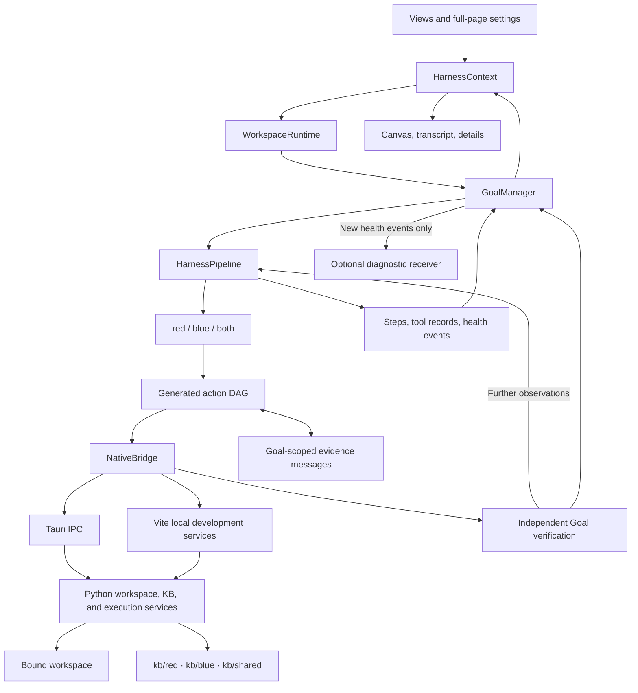

# Desktop architecture

[简体中文](ARCHITECTURE.zh-CN.md) · [Desktop guide](README.md)

Open ReverseLab separates workspace ownership, Goal execution, strategy, tools, and presentation. The canvas and transcript subscribe to execution records; navigating the UI does not select a runner's target or workspace.

## Module boundaries

Views dispatch user actions through the state adapter. `GoalManager` accepts an injected runner and storage implementation; it owns lifecycle, cancellation, revisions, and callback isolation without depending on React. Strategies determine questions and evidence requirements. `DagScheduler` manages dependencies and concurrent runners. Tool adapters supply actual output; the verifier evaluates that output against the objective.

`HarnessPipeline` retains discovery, triage, knowledge lookup, planning, and execution/verification phases. Planning can produce a different action DAG on each round. Independent actions run concurrently, dependent actions receive parent outputs, and failed verification can send the pipeline back to planning. The phase sequence does not prescribe the number or shape of analysis branches.

## Strategy and action graphs

`red` and `blue` have separate policy modules and do not import each other. `both` starts both strategies, keeps their contexts and assessments separate, and verifies the combined objective after their scoped assessments pass.

Each strategy can generate several actions with forks and joins. Before starting an action, the runtime binds its parent outputs and the peer evidence available at that point. Published evidence carries graph-node references; the canvas draws those cross-strategy links. A peer's conclusion remains evidence for assessment rather than directly changing the other strategy's result.

The scheduler runs a validated, immutable DAG. A later planning round creates another DAG and retains earlier graph records. Manual graph editing, adding arbitrary nodes to an already running DAG, and arbitrary user-defined Agent roles are not exposed by the current desktop UI.

## Ownership and persistence

| Object | Owns | Lifetime |
| --- | --- | --- |
| Workspace runtime | A bound workspace root, Goal manager, serialized writes | Remains loaded when another workspace becomes visible |
| Goal | Target, objective revisions, strategy, budget, transcript, evidence | From creation through its recorded terminal state |
| Strategy context | Acceptance plan, routes, actions, observations, assessment | One strategy execution within a Goal revision |
| Action | Dependencies, input bindings, script, output, cancellation signal | One execution within a planning round |
| View | Selection, draft, expansion, zoom, and reading position | Presentation state; it does not retarget work |

Goal submission copies target, objective, strategy, and optional budget. Model/provider settings are copied when a pipeline execution starts, rather than when a request enters the queue. Both strategies receive the same model snapshot. A revision starts a new pipeline execution after the previous execution yields, with the remaining Goal budget.

There is no default limit on concurrent Goals or ready DAG actions. Dependencies and any explicitly supplied resource locks still determine readiness. `DagResourcePool` supports sharing locks between schedulers, but the current generated action schema does not attach resource keys or install a workspace-wide resource pool. Integrations that need exclusive devices or debugger sessions must wire that ownership explicitly.

Workspace data is stored beneath `.reverselab/`. The browser development server and Tauri call the same Python workspace and KB implementations. Workspace writes are serialized; reports are bound to the original Goal, strategy attempt, and workspace. Reopening history marks interrupted work accordingly and does not restart processes. See [WORKSPACES.md](WORKSPACES.md).

## Presentation and settings

The transcript presents analysis progress while keeping plans, code, structured data, tool output, and verification details expandable. The canvas derives nodes and edges from real step, dependency, and evidence events. Layout, card expansion, viewport movement, and full-screen mode belong to the view layer.

Settings uses a full page for workspace, model, proxy, diagnostics, tool, and update configuration. It calls the relevant service instead of owning execution state. Model credentials and application preferences live in local WebView storage; workspace records remain in the workspace directory.

## Transport and diagnostics

Model requests use `modelFetch`. In the native app, Tauri streams response headers and chunks through an IPC channel and accepts cancellation by request ID. Model and Python proxy policies are independent. Python receives its selected route in the child environment; the updater and Sentry use their own transport paths. Browser preview relies on browser networking and cannot enforce native proxy selection. See [NETWORK.md](NETWORK.md).

Local health events retain the details needed to inspect failures. `HealthMonitor` derives status from observations, leaving unobserved layers unknown. The remote diagnostic receiver is connected to new Goal events, so rendering historical records does not upload them. Optional Sentry collection sanitizes errors and operation timings; disabling it removes listeners and aborts in-flight submissions.

Performance monitoring is a separate, optional native sampler with a UI responsiveness observer. It displays a warning after a sustained condition, pauses while hidden, and releases resources when disabled. Both diagnostic options default to off; details and configuration are in [DIAGNOSTICS.md](DIAGNOSTICS.md).

## Code map

| Responsibility | Entry point |
| --- | --- |
| State adapter | [HarnessContext.tsx](src/state/harness/HarnessContext.tsx) |
| Workspace lifecycle and writes | [workspaceRuntime.ts](src/services/goals/workspaceRuntime.ts) |
| Goal lifecycle and revisions | [goalManager.ts](src/services/goals/goalManager.ts) |
| Phase and route orchestration | [HarnessPipeline.ts](src/engine/pipeline/HarnessPipeline.ts) |
| Generated action execution | [actionPlan.ts](src/engine/pipeline/actionPlan.ts) |
| DAG dependencies and resource ownership | [dagScheduler.ts](src/engine/runtime/dagScheduler.ts) |
| Strategy evidence messages | [agentMessages.ts](src/engine/runtime/agentMessages.ts) |
| Independent verification | [goalVerifier.ts](src/engine/pipeline/goalVerifier.ts), [verifyBothGoal.ts](src/engine/tracks/verifyBothGoal.ts) |
| Model transport and proxy policy | [networkService.ts](src/services/network/networkService.ts), [network.rs](src-tauri/src/network.rs) |
| Local health aggregation | [healthMonitor.ts](src/services/health/healthMonitor.ts) |
| Optional diagnostics | [sentryService.ts](src/services/telemetry/sentryService.ts), [performanceMonitor.ts](src/services/performance/performanceMonitor.ts) |
| Workspace disk operations | [desktop_workspace.py](../scripts/misc/desktop_workspace.py) |
| Knowledge index adapter | [desktop_kb.py](../scripts/misc/desktop_kb.py) |

Runtime contracts and implementation limits are in [AGENT_SYSTEM.md](AGENT_SYSTEM.md). Build checks are in [DEV_GUIDE.md](DEV_GUIDE.md); adversarial acceptance work is tracked separately in [ADVERSARIAL_PROFILES.md](ADVERSARIAL_PROFILES.md).
