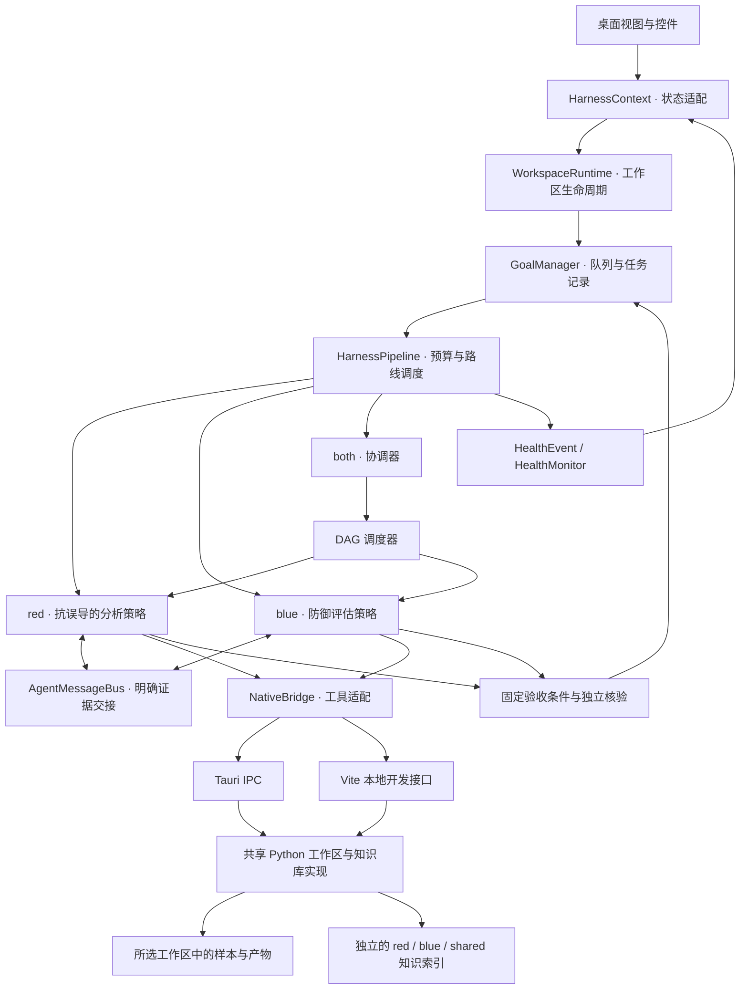
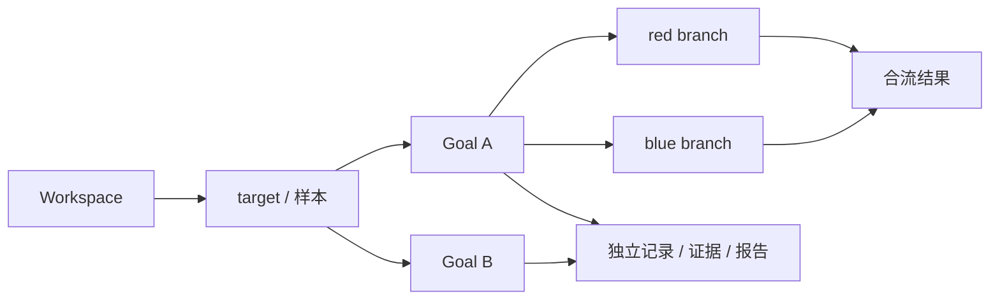

# 桌面架构

## 模块边界

视图不负责规划或调用模型。GoalManager 接受注入的 runner 与存储接口，管理排队、取消与回调隔离。策略决定观察目标和证据要求；DAG 调度器管理依赖、合流、并发与资源锁。消息总线和健康监控均是独立模块。

`red`、`blue` 不互相导入。`both` 通过分支 runner 组合它们，只交换带来源的证据和阻塞信息。普通 Goal 运行单策略，both 使用两个实际异步分支与 `allSettled` 合流节点。通用 DAG 可容纳更多分支，但当前 UI 不提供手工编辑网络的功能。

## 数据归属

工作区是项目数据的边界。Goal 是执行生命周期的边界。Agent 是分支策略的边界。切换当前工作区、选中的 Goal 或界面 track 均不能改变运行中的对象。默认同时运行两个 Goal；每个 both Goal 内有两个策略分支。

模型配置在单次运行启动时形成副本；具体提交队列时的配置语义和限制见运行文档。工作区 API 与 KB API 分开，切换工作区不会复制或改写公共知识库。

## 代码入口

| 职责 | 文件 |
| --- | --- |
| 工作区生命周期 | [workspaceRuntime.ts](src/services/goals/workspaceRuntime.ts) |
| 多 Goal 队列 | [goalManager.ts](src/services/goals/goalManager.ts) |
| 策略调度 | [HarnessPipeline.ts](src/engine/pipeline/HarnessPipeline.ts) |
| 分支与合流 | [dagScheduler.ts](src/engine/runtime/dagScheduler.ts) |
| Agent 通讯 | [agentMessages.ts](src/engine/runtime/agentMessages.ts) |
| 目标核验 | [goalVerifier.ts](src/engine/pipeline/goalVerifier.ts) |
| 错误分类 | [healthMonitor.ts](src/services/health/healthMonitor.ts) |
| 工作区磁盘操作 | [desktop_workspace.py](../scripts/misc/desktop_workspace.py) |
| 知识索引适配 | [desktop_kb.py](../scripts/misc/desktop_kb.py) |

详细契约见 [AGENT_SYSTEM.md](AGENT_SYSTEM.md)。工作区、对抗目标、错误码、界面规范分别记录在 [WORKSPACES.md](WORKSPACES.md)、[ADVERSARIAL_PROFILES.md](ADVERSARIAL_PROFILES.md)、[ERROR_CODES.md](ERROR_CODES.md)、[DESIGN_BRIEF.md](DESIGN_BRIEF.md)。
