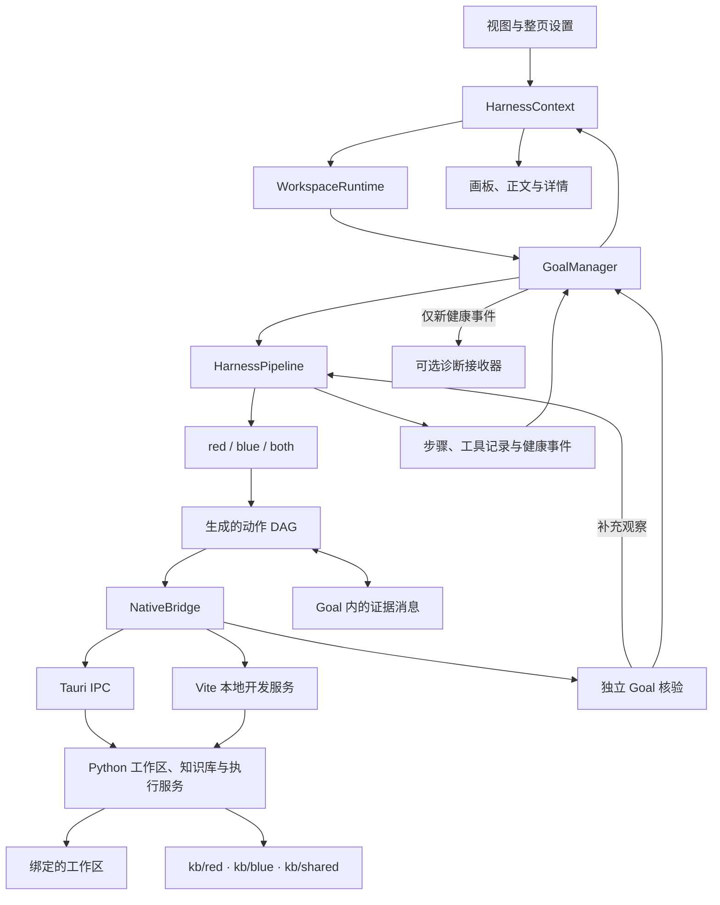

# 桌面架构

[English](ARCHITECTURE.md) · [桌面使用指南](README.zh-CN.md)

Open ReverseLab 将工作区归属、Goal 执行、策略、工具和界面分开。画板与正文订阅执行记录，切换界面不会改变执行器的目标或工作区。

## 模块边界

视图经状态适配层分发用户操作。`GoalManager` 接受注入的 runner 和存储实现，不依赖 React，管理生命周期、取消、目标修订与回调隔离。策略确定问题和证据要求，`DagScheduler` 管理依赖与并发执行。工具适配器返回真实输出，核验器根据原目标评估输出。

`HarnessPipeline` 保留目标发现、初筛、知识检索、规划、执行与核验等阶段。每轮规划可以产生不同的动作 DAG，独立动作同时执行，依赖动作接收父节点输出，核验缺口可以触发下一轮规划。阶段顺序不预先规定分析分支的数量或形状。

## 策略与动作网络

`red` 与 `blue` 使用独立策略模块，不互相导入。`both` 启动两方策略，分别保留上下文与核验结果；各自职责通过核验后，再核验完整目标。

每种策略都可以生成多个动作并形成分叉与汇合。动作开始前绑定父动作输出，以及当时已经收到的对方证据。发布的证据携带画板节点引用，画板据此绘制跨策略连线。对方结论作为待评估证据传递，不直接改写另一方的判定。

调度器运行经过校验的不可变 DAG，后续规划轮次创建新 DAG 并保留之前的画板记录。当前桌面界面尚未提供手工编辑网络、向正在运行的 DAG 任意插入节点或自定义任意 Agent 角色的入口。

## 数据归属与持久化

| 对象 | 拥有的数据 | 生命周期 |
| --- | --- | --- |
| 工作区运行时 | 绑定的工作区根目录、Goal 管理器、串行写入队列 | 切换到其他工作区后继续保留 |
| Goal | 目标、任务修订、策略、预算、正文与证据 | 从创建到记录最终状态 |
| 策略上下文 | 验收计划、路线、动作、观察与核验结果 | Goal 某次修订中的策略执行 |
| 动作 | 依赖、输入绑定、脚本、输出与取消信号 | 一轮规划中的一次执行 |
| 视图 | 选择、草稿、展开、缩放与阅读位置 | 界面状态，不改变执行归属 |

提交 Goal 时复制目标、任务、策略与可选预算。模型和提供商配置在 pipeline 开始执行时复制，而非进入队列时复制；both 两方使用同一份模型快照。目标修订会在上一轮执行交还控制后启动新 pipeline，继续使用该 Goal 剩余的预算。

并发 Goal 与就绪 DAG 动作默认均不设数量上限；依赖关系和显式传入的资源锁仍决定何时可以执行。`DagResourcePool` 支持多个调度器共享锁，但当前生成动作的 schema 不包含资源 key，也没有安装工作区级共享资源池。设备或调试会话需要互斥时，相应适配器须明确接入资源归属。

工作区数据存放在 `.reverselab/` 中。浏览器开发服务与 Tauri 使用相同的 Python 工作区、知识库实现。工作区写入串行执行，报告绑定原始 Goal、策略尝试与工作区。重新打开历史会标明中断状态，不会重新启动外部进程。详见[工作区说明](WORKSPACES.zh-CN.md)。

## 界面与设置

正文展示分析进展，计划、代码、结构化数据、工具输出与核验明细按需展开。画板根据真实步骤、依赖与证据事件生成节点和连线。布局、卡片展开、视口移动与全屏属于视图层。

设置采用整页布局，包含工作区、模型、代理、诊断、本机工具和更新配置，通过对应服务操作数据，不接管执行状态。模型凭据与应用偏好保存在本机 WebView 存储，工作区记录保存在工作区目录。

## 传输与诊断

模型请求通过 `modelFetch` 发送。原生应用使用 Tauri IPC 通道传输响应头与流式数据，并按请求 ID 取消。模型与 Python 的代理策略独立；Python 在子进程环境中接收选定路由，更新器和 Sentry 使用自己的传输路径。浏览器预览使用浏览器网络设置，无法强制应用原生代理策略。详见[代理池](NETWORK.zh-CN.md)。

本地健康事件保留检查故障所需的详情。`HealthMonitor` 根据观察汇总状态，未观测的层保持未知。远程诊断接收器订阅新 Goal 事件，渲染历史记录不会补传事件。可选的 Sentry 对错误与操作耗时脱敏，关闭时移除监听并取消在途发送。

性能监测使用独立的可选原生采样器与界面响应观察器，持续异常后才提醒，隐藏时暂停，关闭时释放资源。两种诊断默认均关闭，详见[诊断说明](DIAGNOSTICS.zh-CN.md)。

## 代码入口

| 职责 | 文件 |
| --- | --- |
| 状态适配 | [HarnessContext.tsx](src/state/harness/HarnessContext.tsx) |
| 工作区生命周期与写入 | [workspaceRuntime.ts](src/services/goals/workspaceRuntime.ts) |
| Goal 生命周期与修订 | [goalManager.ts](src/services/goals/goalManager.ts) |
| 阶段与路线编排 | [HarnessPipeline.ts](src/engine/pipeline/HarnessPipeline.ts) |
| 生成动作的执行 | [actionPlan.ts](src/engine/pipeline/actionPlan.ts) |
| DAG 依赖与资源归属 | [dagScheduler.ts](src/engine/runtime/dagScheduler.ts) |
| 策略证据消息 | [agentMessages.ts](src/engine/runtime/agentMessages.ts) |
| 独立核验 | [goalVerifier.ts](src/engine/pipeline/goalVerifier.ts)、[verifyBothGoal.ts](src/engine/tracks/verifyBothGoal.ts) |
| 模型传输与代理策略 | [networkService.ts](src/services/network/networkService.ts)、[network.rs](src-tauri/src/network.rs) |
| 本地健康汇总 | [healthMonitor.ts](src/services/health/healthMonitor.ts) |
| 可选诊断 | [sentryService.ts](src/services/telemetry/sentryService.ts)、[performanceMonitor.ts](src/services/performance/performanceMonitor.ts) |
| 工作区磁盘操作 | [desktop_workspace.py](../scripts/misc/desktop_workspace.py) |
| 知识索引适配 | [desktop_kb.py](../scripts/misc/desktop_kb.py) |

运行契约与实现边界见 [AGENT_SYSTEM.zh-CN.md](AGENT_SYSTEM.zh-CN.md)，构建检查见[开发指南](DEV_GUIDE.zh-CN.md)，对抗验收单独记录在 [ADVERSARIAL_PROFILES.md](ADVERSARIAL_PROFILES.md)。
