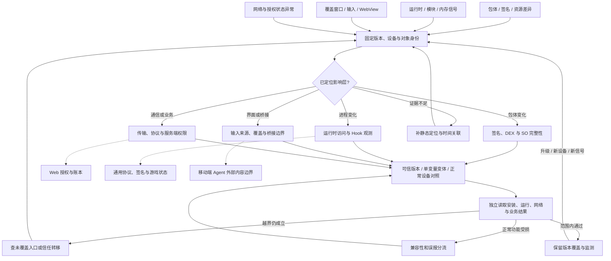

# Android 防御网：包体、运行时、界面与服务端证据

入口是包体、设备和业务系统的可观察差异。[攻击网](../../../red/apk-reverse/techniques/attack-network.md)用于提出假设；本图将假设连接到防护位置、独立证据和正常功能回归。设备上的检测信号、客户端执行结果、服务端授权结果分别记录。

## 1. 全网图与防御工作流



## 2. 观测入口与已有防线

| 入口 | 需要保留的证据 | 防御文档 | 正常/异常验证 |
|---|---|---|---|
| DEX、smali 或 APK 变化 | 原包/变体摘要、构建版本、变更位置、安装来源 | [Smali 篡改](01-dex-java/01-smali-injection-defense.md)、[签名完整性](08-patch-repack/02-signature-integrity-bypass-defense.md) | 官方/测试可信版本能运行，变体触发的检测与业务结果可关联 |
| 新 SO、依赖或加载变化 | SO 摘要、架构、加载时机、调用来源 | [SO 注入与重打包](08-patch-repack/01-so-injection-repack-defense.md) | 对照正常插件、动态组件与变体，检查实际敏感操作 |
| 内存读写、附加、Hook 信号 | 进程身份、模块映射、被修改地址、事件时间 | [内存与 Hook](06-dynamic/01-memory-rw-hook-defense.md) | 不仅看检测提示，还看目标状态是否改变 |
| 覆盖窗口或异常手势 | 前后台状态、窗口来源、输入序列及用户操作 | [Overlay](06-dynamic/02-overlay-rendering-hook-defense.md)、[触摸输入](06-dynamic/03-touch-input-hook-defense.md) | 辅助功能、输入法、分屏与测试自动化作为正常对照 |
| WebView 导航、JS bridge 或混合框架异常 | URL/Origin、frame、桥接方法、参数与宿主能力 | [WebView](09-hybrid-frameworks/01-webview-attacks-defense.md)、[混合框架](09-hybrid-frameworks/02-cordova-reactnative-defense.md) | 合法页面仍可操作，非预期来源不能获得宿主能力 |
| 代理、证书或协议异常 | 实际请求、TLS 配置、会话与服务端响应 | [TLS pinning](05-network/03-tls-pinning-unpinning-defense.md)、[协议 Hook](05-network/01-game-protocol-hook-defense.md) | 合法证书轮换与网络错误对照；服务端独立验证请求权限 |
| 本地授权显示与服务端不一致 | 登录主体、许可证状态、缓存版本、实际服务结果 | [在线许可证](05-network/02-license-verification-bypass-defense.md) | 从新会话查询受保护资源，检查撤权、到期和离线策略 |

## 3. 跨层分叉

### 路径 A：重打包后仍可调用受保护服务

```text
包体差异 → 客户端检测是否触发 → 服务端看到的身份与完整性信号
  ├─ 服务端授权错误 → Web 对象权限、会话与业务规则
  ├─ 本地显示授权但远端拒绝 → 区分显示篡改和实际权益变化
  └─ 离线功能允许 → 核对产品离线授权范围和有效期
```

接入 [Web 业务授权防御](../../ctf-website/techniques/14-idor/02-bac-business-logic-defense.md)。客户端检测与云端授权是不同控制点，均需实际证据。

### 路径 B：封包没有变，服务器状态仍异常

检查重复提交、并发、客户端时间和业务状态转移。接入 [General 重放防御](../../general/techniques/signature/06-replay-nonce-defense.md)和 [Web 交易竞态](../../ctf-website/techniques/12-payment/payment-race-lost-update-defense.md)，用服务端账本及事务结果确认。

### 路径 C：WebView 或插件内含 Agent

浏览器源与桥接权限之外，还要沿 [AI 外部内容防御](../../general/techniques/ai-security/01-indirect-prompt-injection-defense.md)检查检索文本是否影响工具调用。正常加载网页与允许执行页面提出的动作分别判定。

## 4. 证据与独立验证

每轮记录构建版本、Android/API 版本、ABI、安装来源、设备状态、应用身份和测试输入。正文中的检测方案先在目标版本上验证支持情况，不能从示例代码推断设备已受保护。

```sh
python scripts/misc/kb_router.py "APK signature integrity" --board apk-reverse --track blue
python scripts/misc/kb_router.py "WebView bridge origin" --board apk-reverse --track blue
```

命令只路由知识。将安装/运行记录、必要网络证据和服务端回执放在本地 `exports/android/<case>/`，用 `observed / recommended / unverified` 区分已发生事件、建议措施与缺口。

| 结果 | 判定与下一步 |
|---|---|
| 异常变体被拒绝，正常版本可用，服务端权益无变化 | 当前测试组合通过；记录未测设备与入口 |
| 检测告警但异常业务动作成功 | 沿服务器权限与异步消费链继续分析 |
| 测试进程崩溃 | 查兼容性、插桩和异常路径，不能直接归为防御成功 |
| 正常设备大面积告警 | 对照 OEM、辅助功能、合法插件和发布版本，调整条件 |
| 没有客户端事件 | 查采集遗漏和路径未触达，补静态调用链与运行触发证据 |

## 5. 当前覆盖边界

现有蓝队正文侧重包体、Hook、界面、网络和授权。独立的导出组件/Intent、ContentProvider、备份与本地数据存储、Keystore 生命周期、Play Integrity 服务端验证、JNI 内存安全、SELinux/内核驱动防护正文仍待补充。对应静态或攻击篇可提供定位线索，不能视为完整防御方案。

系统级或硬件威胁接入 [General 防御网](../../general/techniques/defense-network.md)的覆盖缺口节点；Windows 配套客户端进入 [PE 防御网](../../pe-reverse/techniques/defense-network.md)。

## MCP 工具映射

| 阶段 | 工具 | 能力边界 |
|---|---|---|
| 按信号找路线 | `kb_router` | 使用 `board="apk-reverse"` 读取蓝队条目 |
| 选择配置与验证步骤 | `kb_read_file` | 读取对应防御文档和配对分析方法 |
| 确认覆盖 | `kb_catalog` | 查看已有正文；不判断设备是否被攻陷或加固是否生效 |

APK 静态分析、动态观测与服务端复核使用正文对应工具，分别保留结果与失败原因。
