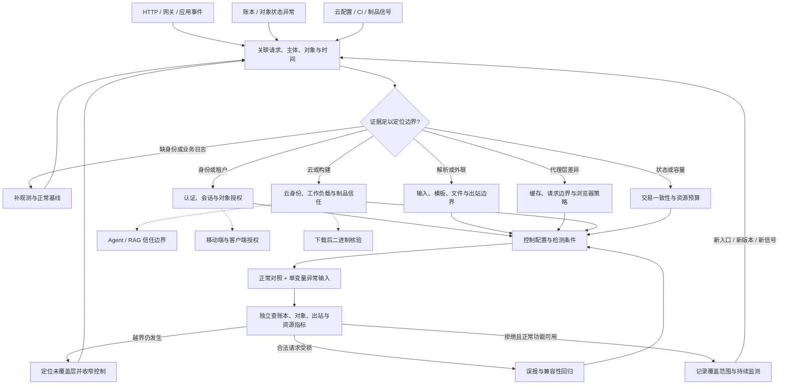

# Web 防御网：身份、输入、基础设施与业务结果复核

防御网以需要保护的对象和实际观测结果为入口。节点代表调查或控制阶段，边代表需要补齐的证据；从[攻击网](../../../red/ctf-website/techniques/attack-network.md)得到的假设，在这里转成可验证的防护路径。链接存在表示已有知识入口，具体规则和配置仍需按部署环境验证。

## 1. 全网图与工作流



## 2. 信号到控制的导航

| 入口信号 | 先补的证据 | 已有防御路径 | 独立确认点 |
|---|---|---|---|
| 登录、token、SSO 或 passkey 异常 | 主体、认证方式、challenge/会话关联、拒绝阶段 | [JWT](02-auth/jwt/00-overview-defense.md)、[OAuth](02-auth/oauth-sso-defense.md)、[SAML](02-auth/saml-attacks-defense.md)、[WebAuthn/passkey](02-auth/webauthn-passkey-defense.md) | 认证失败是否仍创建会话；合法用户仍可登录 |
| 对象 ID、租户或角色变化 | 服务端身份、目标对象所有者、实际读写结果 | [IDOR](14-idor/01-idor-enumeration-defense.md)、[业务授权](14-idor/02-bac-business-logic-defense.md)、[批量赋值](15-mass-assignment/01-mass-assignment-defense.md) | 两个合成用户交叉操作，核对数据库/业务状态 |
| 查询错误、模板执行、反序列化信号 | 入口字段、解析器、调用链、数据库副作用 | [SQL/NoSQL](03-injection/sqli-nosqli-defense.md)、[SSTI](03-injection/ssti-defense.md)、[反序列化](05-deserialization/deserialization-defense.md)、[GraphQL](03-injection/graphql-defense.md) | 参数/类型处理与下游查询实际结果 |
| URL 取回、上传、路径读取异常 | 规范化后目标、重定向链、解析器及文件落点 | [SSRF](04-ssrf/ssrf-defense.md)、[文件攻击](06-file-attacks/file-upload-xxe-lfi-defense.md)、[预签名对象存储](10-cloud/presigned-object-storage-defense.md) | 出站记录、存储对象、读取身份与文件消费流程 |
| 代理/缓存返回与源站不一致 | 各跳请求边界、缓存键、身份与响应归属 | [请求走私/缓存/竞态](08-infra/race-cache-smuggling-defense.md)、[缓存欺骗](08-infra/web-cache-deception-defense.md)、[HTTP/2](08-infra/http2-attacks-defense.md) | 隔离连接与跨用户对照，核查源站而非只看边缘状态码 |
| 浏览器跨域、消息或脚本行为异常 | Origin、消息源、会话、实际 DOM/网络效果 | [CORS/CSRF](07-client/cors-csrf-defense.md)、[postMessage](07-client/postmessage-defense.md)、[CSP](18-cors-csp-advanced/01-csp-bypass-defense.md)、[WebSocket](07-client/websocket-defense.md) | 真实浏览器正常/异常来源对照 |
| 云角色、K8s 或 CI 权限过宽 | 当前有效身份、策略及绑定、被操作资源 | [IAM](10-cloud/aws-iam-privesc-defense.md)、[RBAC](10-cloud/k8s-rbac-attack-paths-defense.md)、[Actions](10-cloud/github-actions-abuse-paths-defense.md)、[Terraform](10-cloud/terraform-state-secrets-defense.md) | 从实际角色做允许/拒绝对照；策略扫描结果需有效权限复核 |
| 下载的制品来源不明 | 字节摘要、验证器结果、signer/builder/source 预期 | [构建制品 provenance](11-supply-chain/artifact-provenance-verification-defense.md)、[依赖混淆](11-supply-chain/dependency-confusion-defense.md) | 消费的是已验证摘要对应的制品 |
| 重复支付、回调、库存或配额异常 | 业务幂等键、事务状态、回调验证、账本变化 | [异步回调](12-payment/payment-callback-async-defense.md)、[竞态更新](12-payment/payment-race-lost-update-defense.md)、[订阅](12-payment/payment-subscription-defense.md) | 独立账本核对，重放/并发后只发生授权变化 |
| 超时、CPU/内存/连接或账单上升 | 每租户请求、耗时、队列、资源消耗及正常峰值 | [应用层 DoS](22-dos/01-application-layer-dos-defense.md)、[API 滥用](22-dos/10-api-abuse-defense.md)、[数据库 DoS](22-dos/13-database-dos-defense.md) | 有界负载下限制生效且正常用户可用 |
| 域名、邮件或数据库暴露 | DNS/邮件身份链、存储权限、历史暴露范围 | [子域接管](19-dns-email/01-subdomain-takeover-defense.md)、[邮件伪造](19-dns-email/02-email-spoofing-defense.md)、[备份日志](24-database/05-backup-log-leak-defense.md) | 对应解析/身份或存储配置已改变，历史暴露单独处置 |

## 3. 多路径防御与跨板块连接

### 路径 A：认证通过后出现跨用户结果

```text
验证 session 与主体 → 对象授权 → 缓存键与缓存内容身份
  ├─ 源站已拒绝、缓存仍返回 → 缓存隔离路径
  ├─ 接口拒绝、下载链接仍可用 → 对象存储签发与既有授权路径
  └─ 模型回答包含另一用户材料 → General RAG 授权与缓存路径
```

连接 [RAG 授权防御](../../general/techniques/ai-security/03-rag-authorization-poisoning-defense.md)。不要只修登录层而漏掉下载、搜索、导出、预览和后台任务。

### 路径 B：移动端显示拒绝，服务端仍改变状态

从 [APK 防御网](../../apk-reverse/techniques/defense-network.md)确认客户端采集与网络请求，再在本板块复核授权和业务账本。客户端完整性与服务端权限分别记录结果；界面提示不能代替服务端判断。

### 路径 C：构建来源正常，运行行为异常

先确认 provenance 绑定下载的实际字节，再进入 [PE 防御网](../../pe-reverse/techniques/defense-network.md)检查加载、持久化和行为。来源核验与二进制行为结论保留各自证据，避免把签名结果当成行为判定。

## 4. 证据与验证闭环

每轮选一个可证伪命题，例如“租户 A 不能为 B 的对象取得下载授权”，同时保留正常租户下载对照。记录 `observed`、`recommended`、`unverified` 三种状态。

```sh
python scripts/misc/kb_router.py "WebAuthn challenge origin" --board ctf-website --track blue
python scripts/misc/kb_router.py "presigned object storage" --board ctf-website --track blue
```

命令用于选择正文；不会自动测试线上资产。证据建议保存到本地 `exports/ctf-website/<case>/`，包含输入差异、身份/资源引用、控制决定、独立业务结果、正常对照和版本。公开库只保留合成示例。

| 结果 | 后续动作 |
|---|---|
| 拦截日志存在且无越界效果，正常对照可用 | 记录本次版本和入口的覆盖范围，接入监测 |
| 返回拒绝但业务已变化 | 检查先执行后校验、异步任务、重试与事务提交 |
| 请求失败且日志缺失 | 补观测，区分网络失败和防护拒绝 |
| 所有输入都被拒绝 | 修复正常流程；不可用状态不算该控制验证完成 |
| 检测告警多但无证据链 | 按已知运维、扫描、测试流量建立对照，再调整阈值 |

## 5. 当前未覆盖的节点

当前正文尚未形成独立的 Webhook 通用签发/验证、WebTransport、浏览器扩展供应链、DNSSEC 部署与恢复操作指南。支付回调、WebSocket、邮件和子域文档可作为相邻入口，但不能代表这些专题已覆盖。新发现按边界进入现有网络，证据不足时停在“待验证”节点。

## MCP 工具映射

| 阶段 | 工具 | 能力边界 |
|---|---|---|
| 输入信号路由 | `kb_router` | 查 `board="ctf-website"` 的蓝队路径 |
| 读取正文和配对技术 | `kb_read_file` | 获取配置、验证方法和下一跳 |
| 浏览覆盖范围 | `kb_catalog` | 确认文档是否存在；不证明生产控制已启用 |

实际请求、日志、云策略和业务状态验证使用对应正文中已确认可用的工具，并记录版本和结果。
