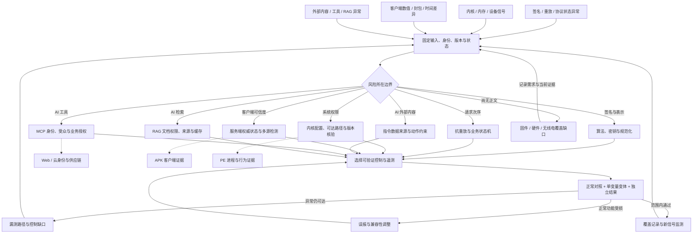

# 通用防御网：密码协议、系统状态与 AI 信任边界

本网络面向跨平台边界：谁提供输入、谁拥有权限、哪个组件执行动作、从哪里验证效果。[攻击网](../../../red/general/techniques/attack-network.md)提供假设路径；防御网从观测出发，选择控制位置并保留未验证分支。固件、硬件与无线电在攻击网有节点，但当前缺乏对应蓝队正文，明确列为待补覆盖。

## 1. 全网图与防御工作流



## 2. 观测与防守路径

| 入口信号 | 关键证据 | 防御路径 | 独立验证 |
|---|---|---|---|
| 签名算法或验签行为异常 | 原始字节、算法/密钥类型、验证结果与业务效果 | [算法绑定](signature/01-algorithm-defense.md)、[实现缺陷](signature/02-implementation-defense.md) | 合法、改动、类型错误及缺字段对照 |
| 同义请求有不同验证结果 | 解析前字节、解析后对象、规范化规则与重复字段 | [规范化](signature/04-canonicalization-defense.md)、[长度扩展](signature/05-length-extension-defense.md) | 独立重算签名与服务端结果一致 |
| 密钥暴露或跨用途复用 | 密钥标识/用途、来源、有效期及使用记录 | [密钥生命周期](signature/03-key-attacks-defense.md) | 轮换后的新旧凭据和依赖方分别测试 |
| 重放、乱序、重复扣减 | nonce/请求 ID、时窗、处理次序、状态转移 | [抗重放](signature/06-replay-nonce-defense.md) | 并发与顺序重放后核对实际账本 |
| page cache、内核对象或异常权限变化 | 精确内核构建、配置、对象/FD 证据及触发路径 | [page-cache](01-kernel/01-page-cache-write-family-defense.md)、[slab](01-kernel/02-slab-cross-cache-defense.md)、[ptrace/FD](01-kernel/03-mm-null-ptrace-bypass-defense.md)、[CIFS](01-kernel/04-cifswitch-nss-privesc-defense.md)、[io_uring](01-kernel/05-pintheft-io-uring-page-cache-defense.md) | 先核实适用版本与厂商补丁；在匹配环境验证缓解效果 |
| 游戏数值、封包、视野、时钟异常 | 客户端与服务端状态、事件时间、协议序列 | [内存](cheating/01-memory-hacking-defense.md)、[封包](cheating/02-packet-interception-defense.md)、[渲染](cheating/03-esp-wallhack-rendering-defense.md)、[时间](cheating/05-speedhack-time-manipulation-defense.md)、[反作弊](cheating/04-anti-cheat-bypass-defense.md) | 合法高延迟、辅助功能、驱动与版本变化作为对照 |
| Agent 读外部文档后改任务或提新动作 | 来源链、上下文、动作建议、执行决定与副作用 | [间接提示注入](ai-security/01-indirect-prompt-injection-defense.md) | 合成 canary 对照与执行端替身，区分摘录和越界执行 |
| 工具定义变更、错 token 受众、session 串线 | server/tool 身份、schema 摘要、验证结果、下游回执 | [MCP 信任边界](ai-security/02-mcp-trust-boundary-defense.md) | 不同服务器、主体、受众、对象逐项对照 |
| RAG 跨租户、撤权残留或知识投毒 | 文档/chunk 来源、ACL/索引版本、缓存及模型输入 | [RAG 授权与投毒](ai-security/03-rag-authorization-poisoning-defense.md) | 检索、重排、上下文、引用和缓存的双租户复核 |

内核条目的存在只说明有分析入口；具体漏洞版本、补丁状态和缓解兼容性必须回到发行版/上游公告核实，不能由网络节点推断当前主机受影响。

## 3. 交叉边与路径分叉

### 路径 A：签名验证成功但业务结果异常

```text
算法和密钥用途 → 签名覆盖字段 → 规范化 → nonce/时窗 → 当前主体/对象授权
  ├─ 请求合法但重复消费 → 幂等与状态机
  ├─ 身份真实但目标越权 → Web 对象授权
  └─ 签名对应另一份制品 → 构建 provenance subject digest
```

转 [Web 防御网](../../ctf-website/techniques/defense-network.md)或[制品验证](../../ctf-website/techniques/11-supply-chain/artifact-provenance-verification-defense.md)。密码学验证、业务权限与防重放分别观察。

### 路径 B：RAG 内容影响 MCP 工具动作

```text
入库来源与 ACL → 检索/缓存 → 上下文来源 → 模型动作建议
  → MCP 工具身份与参数 → 当前用户/资源权限 → 下游业务状态
```

若检索材料本就越权，先修 RAG 数据边界；若材料可读却诱导未授权动作，沿提示注入和执行授权路径；若执行身份被混淆，沿 MCP/OAuth 路径。保留同一关联 ID，避免每个组件只证明自己返回了正常状态。

### 路径 C：客户端观测与服务端状态冲突

接入 [APK 防御网](../../apk-reverse/techniques/defense-network.md)和 [PE 防御网](../../pe-reverse/techniques/defense-network.md)，交叉比较内存、网络和服务端。进程内数值变化、UI 变化与服务器状态变化按不同结果记录。

## 4. 可运行路由与证据闭环

```sh
python scripts/misc/kb_router.py "RAG tenant ACL stale cache" --board general --track blue
python scripts/misc/kb_router.py "signature replay nonce" --board general --track blue
```

路由后选择正文中的离线 fixture 或匹配环境的验证步骤。证据保存在本地 `exports/general/<case>/`：输入、版本、控制条件、正常对照、实际结果、独立复核来源和未测分支。公开正文使用合成标记，不携带真实 token、对象内容或设备标识。

| 状态 | 必须能回答的问题 |
|---|---|
| `observed` | 哪个组件发生了什么，证据在哪，是否有独立旁证？ |
| `recommended` | 控制放在哪一层，计划阻断哪条边，正常行为是什么？ |
| `unverified` | 缺哪个版本/设备/身份/副作用证据，下一步如何取得？ |

检测命中、控制拒绝、无副作用和正常功能可用分别记录。控制失败回到对应边界；正常流程受损进入误报/兼容性分支；遥测缺失先补观测。

## 5. 当前未覆盖的节点

| 缺口 | 当前可做的工作 | 仍需新正文支持的内容 |
|---|---|---|
| 固件/IoT | 保留固件版本、摘要、升级来源和已知配置证据 | Secure Boot、签名更新、防回滚、恢复和设备身份的防御闭环 |
| 硬件 | 记录接口、物理访问和样机状态 | 调试口策略、故障注入、侧信道及安全元件验证 |
| 无线电 | 保留协议、配对与消息序列证据 | BLE/LoRa/NFC 等协议特定的认证、密钥和抗重放验证 |
| AI 模型与训练 | 保留来源、模型版本和数据权限边界 | 模型权重供应链、训练数据投毒、模型提取和隐私攻击专项 |
| 通用事件恢复 | 汇总来源链与受影响对象 | 各平台恢复程序、轮换依赖和灾难恢复演练 |

缺口节点用来限制结论与安排后续取证，不能根据已有密码或协议文章声称这些领域已完成覆盖。

## MCP 工具映射

| 阶段 | 工具 | 能力边界 |
|---|---|---|
| 跨领域信号路由 | `kb_router` | 用 `board="general"` 和蓝队轨道查相关正文 |
| 阅读执行方法 | `kb_read_file` | 获取实验、控制和下一跳 |
| 查看已有/缺失领域 | `kb_catalog` | 核对目录，不运行内核测试或 AI 评测 |

本网络组织知识和证据，不替代真实平台的采集、权限执行或效果验证。
