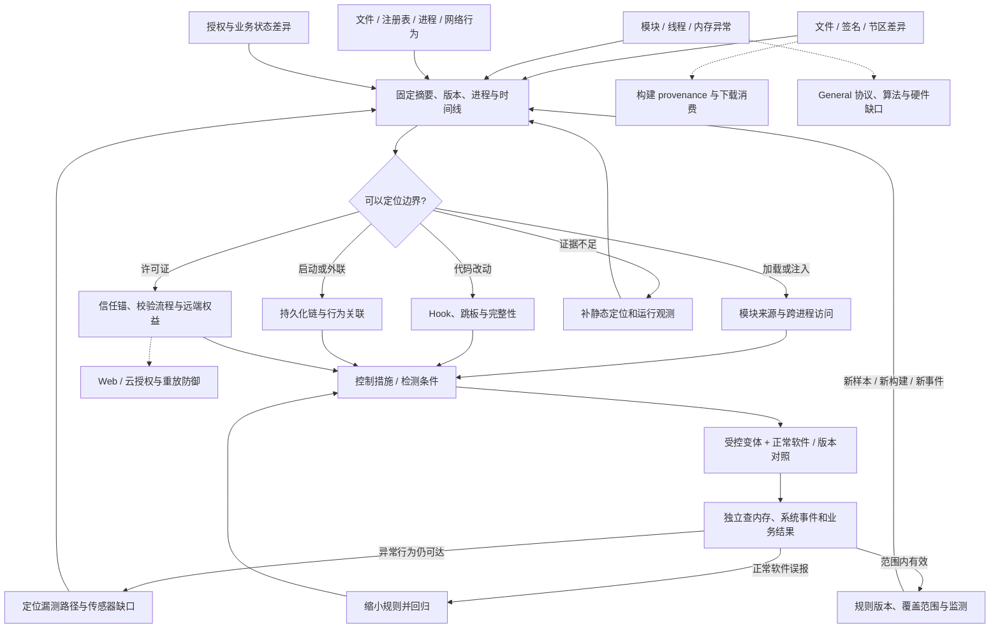

# Windows PE 防御网：加载、内存、持久化与授权复核

本图把文件与运行行为连接到检测和防护验证。由[攻击网](../../../red/pe-reverse/techniques/attack-network.md)提出的注入、Hook、Patch 或授权假设，必须用当前进程、地址、模块与业务结果复核。单个字符串、内存权限或签名状态只作线索，规则草案经正常样本与目标变体检验后才记录覆盖。

## 1. 全网图与防御工作流



## 2. 观测到控制的路径

| 信号 | 首要证据 | 防御入口 | 独立确认 |
|---|---|---|---|
| 新模块或异常 DLL 来源 | 模块路径/摘要、加载时间、加载者及签名验证结果 | [DLL 注入](04-dynamic-analysis/01-dll-injection-defense.md) | 比较正常插件/更新组件，确认实际加载与敏感行为 |
| 未对应正常模块的可执行区域 | 映射类型、权限、内容、线程执行位置与来源 | [Manual Map](04-dynamic-analysis/06-manual-map-injection-defense.md)、[跳板代码](04-dynamic-analysis/04-naked-function-hook-defense.md) | 与 JIT、打包器及合法安全软件对照，多证据再判定 |
| 跨进程访问或状态变化 | 源/目标进程、权限、地址区间、时序和实际值差异 | [外部内存读写](04-dynamic-analysis/03-external-memory-rw-defense.md) | 独立读取目标状态，区分打开句柄与实际改写 |
| 函数入口/代码段变动 | 对应构建原字节、内存字节、跳转目标与调用效果 | [Trampoline](04-dynamic-analysis/02-trampoline-detour-defense.md)、[代码 Patch](08-patch/01-code-patching-defense.md) | 处理重定位、热补丁及合法 Hook 的正常基线 |
| 反调试或 syscall 相关信号 | 具体指令/调用链、运行条件、传感器可见范围 | [反调试防护](04-dynamic-analysis/05-anti-debug-bypass-defense.md)、[Direct Syscall](04-dynamic-analysis/07-direct-syscall-defense.md) | 用目标行为和另一观测源复核，不以某 API 没命中结束 |
| 启动项、文件落地或外联 | 创建者、对象、时间、后续执行与网络关联 | [行为防护](04-dynamic-analysis/08-procmon-patterns-defense.md) | 对照软件安装/更新，核对重启或重新登录后的执行链 |
| 本地许可显示、签名或公钥变化 | 许可证格式、验证结果、信任锚、实际受保护功能 | [机制选型](10-license-keygen/01-license-mechanism-classification-defense.md)、[公钥替换](10-license-keygen/04-signature-chain-pubkey-swap-defense.md)、[云授权](10-license-keygen/06-cloud-license-frida-hook-defense.md) | 新会话和服务端权益复核，区分 UI 状态与真实功能 |
| keygen、状态替换或自引用签名路径 | 校验输入输出、关键条件、字节范围与配置来源 | [算法加固](10-license-keygen/03-key-algorithm-recovery-defense.md)、[进程替换](10-license-keygen/05-keygen-frida-verification-loop-defense.md)、[签名架构](10-license-keygen/07-self-referencing-signature-convergence-defense.md) | 合法许可证、错误签名、过期与撤权对照 |

共享分析入口：[IOC 提取](../../../shared/pe-reverse/techniques/06-ioc-extraction/01-ioc-extraction.md)、[持久化启动链](../../../shared/pe-reverse/techniques/06-ioc-extraction/02-persistence-startup-chain.md)、[YARA 规则](../../../shared/pe-reverse/techniques/07-yara-sigma/01-yara-rule-writing.md)和[规避特征识别](09-av-evasion/01-evasion-indicator-detection.md)。这些材料可补证据与规则，文档标题本身不代表已部署终端检测能力。

## 3. 多源验证与跨域连接

### 路径 A：磁盘未改，进程行为已变化

```text
确认磁盘版本 → 内存代码/映射 → 模块与线程来源 → 文件/网络/业务副作用
  ├─ 正常 JIT 或热补丁 → 建立对应版本正常对照
  ├─ 跨进程改写线索 → 源进程与访问链
  └─ 观测缺失 → 增补传感器并记录不可见范围
```

规则验证保留目标样本与正常软件结果，不能用“没有规则命中”代表未发生行为。

### 路径 B：制品签名可验证，仍有风险行为

先沿 [artifact provenance 防御](../../ctf-website/techniques/11-supply-chain/artifact-provenance-verification-defense.md)确认制品身份、构建来源和消费字节，再分析实际运行行为。可信构建来源、许可证校验与行为风险分别形成结论。

### 路径 C：许可证绕过伴随远端资源访问

接入 [Web 防御网](../../ctf-website/techniques/defense-network.md)与 [General 签名/重放防御](../../general/techniques/signature/06-replay-nonce-defense.md)。核对服务端主体、额度和账本；本地函数返回值不足以确认远端权益变化。

## 4. 证据与复核判定

```sh
python scripts/misc/kb_router.py "manual map memory detection" --board pe-reverse --track blue
python scripts/misc/kb_router.py "license signature integrity" --board pe-reverse --track blue
```

知识路由不会自动扫描样本或生成可靠检测结论。证据保存到本地 `exports/windows/<case>/`，记录文件摘要、OS/架构、地址空间、VA/RVA/文件偏移类型、进程与模块身份、原始/变体差异、规则版本、正常对照及独立副作用结果。

| 结果分支 | 下一步 |
|---|---|
| 异常被检测且预期副作用被阻止，正常软件可运行 | 分别记录检测覆盖和阻断覆盖 |
| 检测命中但行为继续发生 | 判为检测有效、阻断未达目标，定位控制缺口 |
| 样本未运行或先崩溃 | 补入口触达证据，不能直接认定被防护阻断 |
| 合法调试、辅助功能或安全软件触发 | 核对签名、来源、行为和目标范围，缩小误报条件 |
| 只出现壳/高熵/反调试特征 | 继续行为或静态定位，保留“线索”状态 |

## 5. 未覆盖与升级条件

当前正文尚未系统覆盖企业域身份、Windows 事件采集部署、EDR 平台规则语法、驱动签名/WDAC 部署、内核 rootkit、内存取证完整采集和恢复演练。现有 Hook 与内存文档不能替代这些专题。遇到内核/硬件信号转 [General 防御网](../../general/techniques/defense-network.md)，移动端配套进入 [APK 防御网](../../apk-reverse/techniques/defense-network.md)，并记录所需的新观测能力。

## MCP 工具映射

| 阶段 | 工具 | 能力边界 |
|---|---|---|
| 选择蓝队路径 | `kb_router` | 用 `board="pe-reverse"` 路由信号 |
| 读取分析与防护方法 | `kb_read_file` | 获取具体地址/行为的定位和验证步骤 |
| 核对文档覆盖 | `kb_catalog` | 查已有技术；不会自动提供 EDR 遥测或内核防护 |

具体样本工具按正文选择，报告真实可用性、输出和缺失字段。
